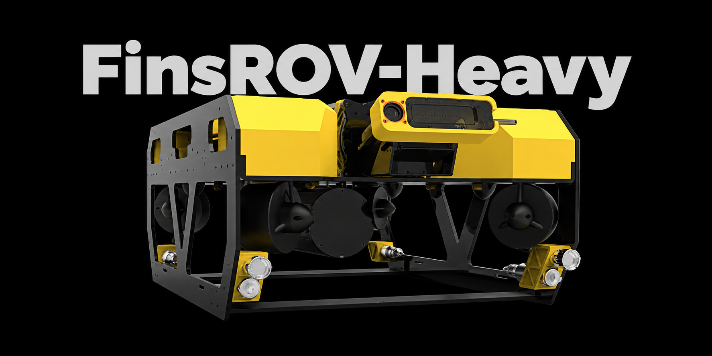

<strong>English</strong> · <a href="README.zh-CN.md" lang="zh-CN">简体中文</a>

# FinsROV-Heavy

FinsROV-Heavy is the open-frame remotely operated vehicle (ROV) used in our underwater inertial odometry experiments. Four horizontal and four vertical thrusters provide propulsion. A RoboMaster Type A controller sends time-stamped IMU readings, depth readings from four pressure sensors, and measured thruster speeds to an onboard Jetson Orin NX.

## Build guide

Start with the [illustrated build tutorials](docs/README.md): parts → frame → power board → thrusters and ESCs → pressure sensors → enclosure trial assembly → Jetson → bring-up → sealing and trim. Detailed instructions are currently in Chinese, with original photographs and downloadable reference files. Unverified steps are identified explicitly.

[Start building](docs/README.md) · [Jetson scripts](software/jetson/README.md) · [Remaining development work](docs/development/remaining-work.zh-CN.md)

## Hardware files

| Assembly | CAD model | Bill of materials |
| --- | --- | --- |
| **Vehicle body** — frame, enclosures, thrusters, buoyancy blocks, camera, lights and external sensors | [Download STEP · 9.7 MiB](hardware/cad/主体装配.step?raw=true) | [Preview CSV](hardware/bom/BOM.csv) · [Download Excel](hardware/bom/BOM.xlsx?raw=true) |
| **Electronics enclosure** — controller, onboard computer, power distribution, speed controllers, connectors and mounting hardware | [Download zipped STEP · 26.2 MiB](hardware/cad/舱内装配.step.zip?raw=true) | [Preview CSV](hardware/bom/BOM-electronics.csv) · [Download Excel](hardware/bom/BOM-electronics.xlsx?raw=true) |

Both bills of materials (BOMs) are in Chinese. The body BOM lists quantities per vehicle, and the electronics BOM lists quantities per enclosure.

### Fabrication drawings and part models

[Mechanical fabrication guide](hardware/mechanical/README.md) · [All 65 source files](hardware/mechanical/FILES.md)

Find CNC end caps, frame plates, buoyancy blocks, FDM mounts and internal mounting parts by BOM ID. The guide identifies matching models, older references and unresolved revision differences. Read it before requesting fabrication.

### Electrical wiring

[Electrical documentation](hardware/electrical/README.md) · [Battery wiring guide and drawings](hardware/electrical/battery-wiring.zh-CN.md) · [Connector and harness workbook](hardware/electrical/battery-wiring.xlsx)

The [system register and three-page drawings](hardware/electrical/system-wiring.zh-CN.md) add 74 functional connections, 17 MCU mappings, 44 harness records and 10 terminal allocation groups, distinguishing source-code pins from author-confirmed functions and unresolved physical connections.

The package documents the battery and [equipment enclosure interfaces](hardware/electrical/equipment-wiring.zh-CN.md). Main power pins **1/2 are battery positive and 3/4 battery negative**; each same-polarity pair connects to one mating LCB60 plug. All supplies previously called “24V” are direct battery supplies whose voltage varies with charge. The pressure sensors take power from EC-07 and communicate through the A-board UART and an RS-485 converter. The three lights use independent PWM channels. Functional allocations of the 20-position and 18-position terminal blocks are confirmed; the 20-position order is chosen for convenient routing. Programming pins and physical board terminals still need documentation.

### Power protection board (EC-07)

The LM5069 board provides soft start and overcurrent protection. The author confirms that R12 was removed from the final EDA design. The repository preserves a fabrication ZIP and a historical interactive BOM that still lists R12. Obtain matching final Gerber, BOM and placement exports before ordering the final revision.

[Open the EasyEDA project](https://oshwhub.com/gan_ju/lm5069-dian-yuan-huan-qi-dong-yu-guo-liu-bao-hu-ban) · [Download PCB fabrication files](hardware/pcb/PowerBoard.zip?raw=true) · [Assembly guide and interactive BOM](docs/build/03-power-board.zh-CN.md)

## Embedded firmware

**SUB is the default firmware for joystick operation.** The inertial-odometry and MAVLink integration versions remain optional experimental configurations.

| Version | Use |
| --- | --- |
| [SUB](firmware/SUB/) | Default: joystick operation and the control assistance already implemented in this snapshot |
| [Inertial odometry](firmware/inertial-odometry/) | Inertial odometry experiments and expanded sensor/actuator telemetry |
| [MAVLink integration build](firmware/integrated/) | New NX bridge and pinned ground-station protocol; locally validated, hardware acceptance pending |

The two legacy snapshots record their FineSUB source commits and pin their dependencies. The integration build reuses the experimental snapshot with a separate control task and protocol adapter. See the build instructions and host protocol settings before selecting a version. [Firmware guide](firmware/README.md)

FineSUB firmware uses the MPL-2.0 licenses included in its source directories. Third-party components carry their own license notices. [Firmware licensing](firmware/README.md#license)

## Jetson software

[Control bridge, video streaming and startup scripts](software/jetson/README.md) for SUB are the default deployment. Follow the [Jetson setup tutorial](docs/build/06-jetson.zh-CN.md) for Ethernet, UART, camera settings and systemd. The matching legacy PC joystick sender, its version and operating instructions still need to be supplied.

The Windows multimode ground station is available in a separate repository: [NXTelemetryMonitor, pinned at `5ebe00e`](https://github.com/ganju2390/NXTelemetryMonitor/tree/5ebe00e2573c8df5b5ad376915fab2da0644c188). It supports joystick and trajectory control, has recorded simulated validation, and uses MAVLink 2. The original SUB bridge and both legacy firmware snapshots in this repository use different protocols and cannot connect directly to the new ground station. Check the software combination and hardware validation status separately; simulation does not establish vehicle readiness.

The optional MAVLink development combination is **the pinned ground station + `fins_bridge` + integrated firmware**. See [deployment, validation and limitations](docs/software/pc-nx-mcu.zh-CN.md). Physical depth hold in this integration build defaults to disabled until sensor calibration and the shared depth datum are verified. Actual onboard inertial-odometry inference and its raw sensor input integration remain pending. These capability flags and limitations belong to the integration build; they do not change SUB behavior.

## Preparing a build

1. **Inspect the assemblies.** Open the vehicle STEP to locate external parts and their mounting points. Extract `舱内装配.step` from the ZIP to inspect the board stack and connector layout. The CAD names in the BOMs identify the corresponding parts.
2. **Group orders by process.** Select the matching files in the [fabrication guide](hardware/mechanical/README.md) and resolve revision differences. Filter the Excel column `准备方式` (preparation method). The four aluminum end caps are CNC-machined. The two identical side plates, top plate and two crossbeams are black-anodized aluminum sheet metal. Camera and light/pressure mounts, internal mounts and battery supports use FDM. The two buoyancy blocks are custom PVC foam at 0.25 g/cm³. Each row lists the available supplier or fabrication link.
3. **Reconcile quantities before ordering.** Electronics rows `REF-01` through `REF-04` refer to parts already counted in the body BOM. The four flange kits together include four face seals and eight radial seals. Check rows marked `待核` (to be confirmed) for missing dimensions, material choices or supplier part numbers before requesting a quote.
4. **Adjust ballast and trim.** The vehicle is positively buoyant before ballast is fitted. Purchase 200 g blocks as needed; the typical setup uses 4–5 blocks, mounted with bore spacers and M4 screws. Adjust the quantity in water for the actual payload. [Ballast instructions](hardware/mechanical/README.md#ballast-and-trim)
