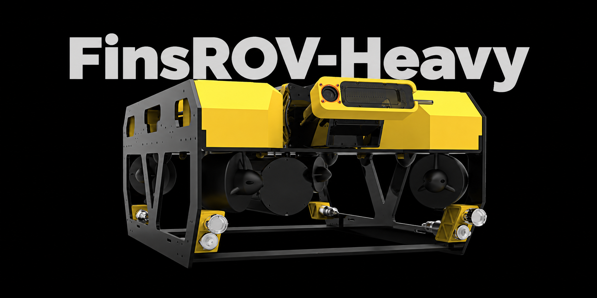

<strong>English</strong> · <a href="README.zh-CN.md" lang="zh-CN">简体中文</a>

# FinsROV-Heavy

FinsROV-Heavy is the open-frame remotely operated vehicle (ROV) used in our underwater inertial odometry experiments. Four horizontal and four vertical thrusters provide propulsion. A RoboMaster Type A controller sends time-stamped IMU readings, depth readings from four pressure sensors, and measured thruster speeds to an onboard Jetson Orin NX.

## Hardware files

| Assembly | CAD model | Bill of materials |
| --- | --- | --- |
| **Vehicle body** — frame, enclosures, thrusters, buoyancy blocks, camera, lights and external sensors | [Download STEP · 9.7 MiB](hardware/cad/主体装配.step?raw=true) | [Preview CSV](hardware/bom/BOM.csv) · [Download Excel](hardware/bom/BOM.xlsx?raw=true) |
| **Electronics enclosure** — controller, onboard computer, power distribution, speed controllers, connectors and mounting hardware | [Download zipped STEP · 26.2 MiB](hardware/cad/舱内装配.step.zip?raw=true) | [Preview CSV](hardware/bom/BOM-electronics.csv) · [Download Excel](hardware/bom/BOM-electronics.xlsx?raw=true) |

Both bills of materials (BOMs) are in Chinese. The body BOM lists quantities per vehicle, and the electronics BOM lists quantities per enclosure.

### Power protection board (EC-07)

The LM5069 board provides soft start and overcurrent protection. Use the EasyEDA project for the editable design and the ZIP for bare PCB fabrication. The ZIP contains Gerber and drill files. Export the component BOM and placement file for the matching board revision before ordering assembly.

[Open the EasyEDA project](https://oshwhub.com/gan_ju/lm5069-dian-yuan-huan-qi-dong-yu-guo-liu-bao-hu-ban) · [Download PCB fabrication files](hardware/pcb/PowerBoard.zip?raw=true)

## Preparing a build

1. **Inspect the assemblies.** Open the vehicle STEP to locate external parts and their mounting points. Extract `舱内装配.step` from the ZIP to inspect the board stack and connector layout. The CAD names in the BOMs identify the corresponding parts.
2. **Group orders by process.** Filter the Excel column `准备方式` (preparation method). The four aluminum end caps are CNC-machined, the two side plates and the top plate are sheet metal, and the camera and light/pressure-sensor mounts are FDM-printed. The two buoyancy blocks are made to order. Each row lists the available supplier or fabrication link.
3. **Reconcile quantities before ordering.** Electronics rows `REF-01` through `REF-04` refer to parts already counted in the body BOM. The four flange kits together include four face seals and eight radial seals. Check rows marked `待核` (to be confirmed) for missing dimensions, material choices or supplier part numbers before requesting a quote.
