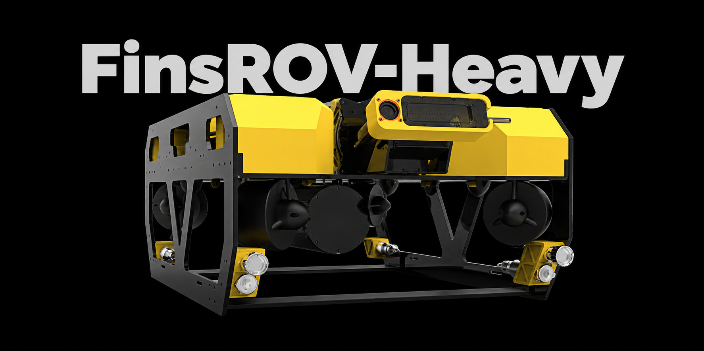

<a href="README.md" lang="en">English</a> · <strong>简体中文</strong>

# FinsROV-Heavy

FinsROV-Heavy 是我们在水下惯性里程计实验中使用的开放式遥控水下机器人（ROV），搭载 4 台水平推进器和 4 台垂直推进器。RoboMaster A 型主控板采集 IMU 数据、4 只压力传感器的深度读数和推进器实测转速，加上时间戳后发送给舱内的 Jetson Orin NX。

## 制作教程

按 [图文制作教程](docs/README.zh-CN.md) 依次完成：备料 → 机架 → 电源板 → 推进器与电调 → 水压计 → 舱内试装 → Jetson → 联调 → 密封与配平。教程保留实装照片和原附件，并标明版本差异与尚未验证的步骤。

[开始制作](docs/README.zh-CN.md) · [Jetson 脚本](software/jetson/README.md) · [后续开发与待补清单](docs/development/remaining-work.zh-CN.md)

## 硬件资料

| 装配 | CAD 模型 | 物料清单 |
| --- | --- | --- |
| **机器人本体** · 机架、密封舱、推进器、浮力块、相机、照明及外装传感器 | [下载 STEP · 9.7 MiB](hardware/cad/主体装配.step?raw=true) | [预览 CSV](hardware/bom/BOM.csv) · [下载 Excel](hardware/bom/BOM.xlsx?raw=true) |
| **舱内装配** · 主控板、机载计算机、配电板、电调、接插件及安装件 | [下载 STEP 压缩包 · 26.2 MiB](hardware/cad/舱内装配.step.zip?raw=true) | [预览 CSV](hardware/bom/BOM-electronics.csv) · [下载 Excel](hardware/bom/BOM-electronics.xlsx?raw=true) |

本体 BOM 的数量按一台机器人计，舱内 BOM 的数量按一个电子舱计。

### 加工图纸与单件模型

[加工与打印说明](hardware/mechanical/README.zh-CN.md) · [65 个原文件完整索引](hardware/mechanical/FILES.md)

按 BOM 编号查找 CNC 舱盖、机架板件、浮力块、FDM 安装件及舱内安装件。说明中列出了当前总装对应模型、旧版参考和待核版本差异，加工询价前请先核对。

### 电气接线

[电气资料目录](hardware/electrical/README.zh-CN.md) · [电池舱接线图与说明](hardware/electrical/battery-wiring.zh-CN.md) · [接口/线束 Excel](hardware/electrical/battery-wiring.xlsx)

[系统接线台账与三页图册](hardware/electrical/system-wiring.zh-CN.md)另提供 74 条功能连接、17 条 MCU 对照、44 组线束记录和 10 组端子分配，区分源码引脚、作者确认功能与实物待核项。

已整理电池舱及[设备舱两端的插座定义](hardware/electrical/equipment-wiring.zh-CN.md)，包含 SVG/PDF 图纸、接口/逐针表和电池 CAN 协议资料。主供电 **1/2 为电池正极、3/4 为电池负极**，同极性两线合并接一个 LCB60 配插头；原称“24V”的供电均为随电量波动的电池直供。20P 压力/PLC/CAN 转接及 18P 灯光/预留端子的功能分组已确认；压力计从 EC-07 取电，A 板串口经 RS-485 转换接入，三灯使用独立 PWM 通道。20P 顺序由复刻者按布线方便安排；烧写口针序和各板物理端子仍需记录。

### 电源缓启动与过流保护板（EC-07）

查看或修改 LM5069 电源板设计请使用立创开源工程。作者已确认最终 EDA 删除 R12，不再作为待决焊接项。仓库保留制板 ZIP 和旧交互式装联 BOM；旧 HTML 仍含 R12，最终版下单前须同步同版 Gerber、BOM 和贴片坐标。

[查看立创开源工程](https://oshwhub.com/gan_ju/lm5069-dian-yuan-huan-qi-dong-yu-guo-liu-bao-hu-ban) · [下载 PCB 制板文件](hardware/pcb/PowerBoard.zip?raw=true) · [焊接教程与交互式 BOM](docs/build/03-power-board.zh-CN.md)

## 嵌入式固件

**默认复刻采用 SUB，仅以手柄操控为当前目标。** 惯性里程计与 MAVLink 集成版保留为可选实验版本，不纳入默认部署。

| 版本 | 用途 |
| --- | --- |
| [SUB](firmware/SUB/) | 默认：手柄操控及该源码已有的控制辅助 |
| [惯性里程计实验](firmware/inertial-odometry/) | 惯性里程计实验及扩展的传感器、执行器遥测 |
| [MAVLink 集成开发版](firmware/integrated/) | 配合新 NX 桥接和固定上位机协议；已完成本地验证，实机验收待完成 |

两套旧版快照记录了各自的 FineSUB 源提交，并固定依赖版本；集成版复用实验快照源码，单独提供控制任务和协议适配。选择固件时请对照编译方法和上位机通信配置。[固件使用说明](firmware/README.zh-CN.md)

FineSUB 固件适用各源码目录中的 MPL-2.0 许可证，第三方组件适用其各自许可证。[固件许可说明](firmware/README.zh-CN.md#许可证)

## Jetson 软件

默认使用配套 SUB 固件的 [控制转发、视频传输和自启动脚本](software/jetson/README.md)。网络、串口、相机参数和 systemd 配置见 [Jetson 教程](docs/build/06-jetson.zh-CN.md)。匹配旧协议的 PC 手柄发送程序、版本与使用说明尚待补齐。

Windows 多模式上位机已在独立仓库提供：[NXTelemetryMonitor · 固定版本 `5ebe00e`](https://github.com/ganju2390/NXTelemetryMonitor/tree/5ebe00e2573c8df5b5ad376915fab2da0644c188)。它支持手柄与轨迹控制，已有模拟联调记录，使用 MAVLink 2 协议。本仓库原有 SUB 转发脚本和两套固件快照使用旧协议，不能直接与新上位机混用。软件组合及实机验证状态须分别核对，模拟通过不代表整机验证完成。

可选的 MAVLink 开发链路使用 **固定上位机 + `fins_bridge` + 集成固件**，见[三端部署、验证与限制](docs/software/pc-nx-mcu.zh-CN.md)。该开发版的实机定深能力默认关闭，须核准传感器标定与共同深度基准后启用；实际惯性里程计推理与原始传感器输入的接入仍待完成。这些限制和能力标志专属于集成版，不改写 SUB 的控制行为。

## 复现顺序

1. **对照装配。** 打开主体 STEP，查看外装件的位置和安装孔位。从压缩包解出 `舱内装配.step`，查看板卡层叠顺序和接插件位置。两份 BOM 都保留了 CAD 名称，方便在模型中定位。
2. **按工艺备料。** 先在[加工与打印说明](hardware/mechanical/README.zh-CN.md)中选定单件，核清版本差异。在 Excel 中筛选「准备方式」。四种铝合金舱盖各 CNC 加工 1 件，两块相同侧板、一块顶板及两根横梁均为铝合金钣金、黑色阳极氧化。相机、灯与水压计固定块、舱内安装件及电池支撑采用 FDM。两块浮力块使用密度 0.25 g/cm³ 的 PVC 发泡材料定制。采购和加工入口见对应物料行。
3. **合并采购数量。** 舱内表的 `REF-01` 至 `REF-04` 已计入本体表。4 套法兰合计随附 4 个端面密封圈和 8 个径向密封圈。遇到「待核」项，先查看该行缺少的尺寸、材料或料号，再向供应商询价。
4. **配平浮力。** 未加配重时平台为正浮力。200 g 铅块按需购买，经验用量为 4–5 块，用垫片适配 M4 螺钉固定；具体数量随实际载荷在水中调整。[附件与配平说明](hardware/mechanical/README.zh-CN.md#配平浮力)
