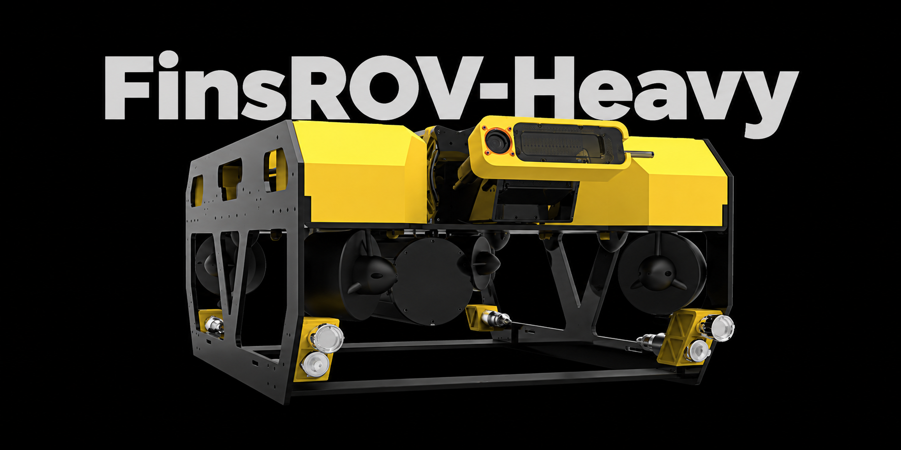

<a href="README.md" lang="en">English</a> · <strong>简体中文</strong>

# FinsROV-Heavy

FinsROV-Heavy 是我们在水下惯性里程计实验中使用的开放式遥控水下机器人（ROV），搭载 4 台水平推进器和 4 台垂直推进器。RoboMaster A 型主控板采集 IMU 数据、4 只压力传感器的深度读数和推进器实测转速，加上时间戳后发送给舱内的 Jetson Orin NX。

## 制作教程

按 [图文制作教程](docs/README.zh-CN.md) 依次完成：备料 → 机架 → 电源板 → 推进器与电调 → 水压计 → Jetson → 联调。教程保留实装照片和原附件，并标明版本差异与尚未补齐的步骤。

[开始制作](docs/README.zh-CN.md) · [Jetson 脚本](software/jetson/README.md) · [待补资料](docs/build/07-bring-up.zh-CN.md#待补资料)

## 硬件资料

| 装配 | CAD 模型 | 物料清单 |
| --- | --- | --- |
| **机器人本体** · 机架、密封舱、推进器、浮力块、相机、照明及外装传感器 | [下载 STEP · 9.7 MiB](hardware/cad/主体装配.step?raw=true) | [预览 CSV](hardware/bom/BOM.csv) · [下载 Excel](hardware/bom/BOM.xlsx?raw=true) |
| **舱内装配** · 主控板、机载计算机、配电板、电调、接插件及安装件 | [下载 STEP 压缩包 · 26.2 MiB](hardware/cad/舱内装配.step.zip?raw=true) | [预览 CSV](hardware/bom/BOM-electronics.csv) · [下载 Excel](hardware/bom/BOM-electronics.xlsx?raw=true) |

本体 BOM 的数量按一台机器人计，舱内 BOM 的数量按一个电子舱计。

### 加工图纸与单件模型

[加工与打印说明](hardware/mechanical/README.zh-CN.md) · [65 个原文件完整索引](hardware/mechanical/FILES.md)

按 BOM 编号查找 CNC 舱盖、机架板件、浮力块、FDM 安装件及舱内安装件。说明中列出了当前总装对应模型、旧版参考和待核版本差异，加工询价前请先核对。

### 电源缓启动与过流保护板（EC-07）

查看或修改 LM5069 电源板设计请使用立创开源工程。制板 ZIP 包含 Gerber 和钻孔文件，可用于裸板下单。现已补充交互式装联 BOM；R12 的焊接状态存在版本冲突，装联前请先核对，再从同版工程导出贴片坐标。

[查看立创开源工程](https://oshwhub.com/gan_ju/lm5069-dian-yuan-huan-qi-dong-yu-guo-liu-bao-hu-ban) · [下载 PCB 制板文件](hardware/pcb/PowerBoard.zip?raw=true) · [焊接教程与交互式 BOM](docs/build/03-power-board.zh-CN.md)

## 嵌入式固件

| 版本 | 用途 |
| --- | --- |
| [SUB](firmware/SUB/) | 正常机器人操控 |
| [惯性里程计实验](firmware/inertial-odometry/) | 惯性里程计实验及扩展的传感器、执行器遥测 |

两套代码记录了各自的 FineSUB 源提交，并固定依赖版本。选择固件时请对照编译方法和上位机通信配置。[固件使用说明](firmware/README.zh-CN.md)

FineSUB 固件适用各源码目录中的 MPL-2.0 许可证，第三方组件适用其各自许可证。[固件许可说明](firmware/README.zh-CN.md#许可证)

## Jetson 软件

已提供配套 SUB 固件的 [控制转发、视频传输和自启动脚本](software/jetson/README.md)。网络、串口、相机参数和 systemd 配置见 [Jetson 教程](docs/build/06-jetson.zh-CN.md)。Windows 手柄上位机和惯性里程计实验协议对应的主机软件尚未提供。

## 复现顺序

1. **对照装配。** 打开主体 STEP，查看外装件的位置和安装孔位。从压缩包解出 `舱内装配.step`，查看板卡层叠顺序和接插件位置。两份 BOM 都保留了 CAD 名称，方便在模型中定位。
2. **按工艺备料。** 先在[加工与打印说明](hardware/mechanical/README.zh-CN.md)中选定单件，核清版本差异。在 Excel 中筛选「准备方式」。四种铝合金舱盖各 CNC 加工 1 件，两块相同侧板、一块顶板及两根横梁均为铝合金钣金、黑色阳极氧化。相机、灯与水压计固定块、舱内安装件及电池支撑采用 FDM。两块浮力块使用密度 0.25 g/cm³ 的 PVC 发泡材料定制。采购和加工入口见对应物料行。
3. **合并采购数量。** 舱内表的 `REF-01` 至 `REF-04` 已计入本体表。4 套法兰合计随附 4 个端面密封圈和 8 个径向密封圈。遇到「待核」项，先查看该行缺少的尺寸、材料或料号，再向供应商询价。
4. **配平浮力。** 未加配重时平台为正浮力。200 g 铅块按需购买，经验用量为 4–5 块，用垫片适配 M4 螺钉固定；具体数量随实际载荷在水中调整。[附件与配平说明](hardware/mechanical/README.zh-CN.md#配平浮力)
