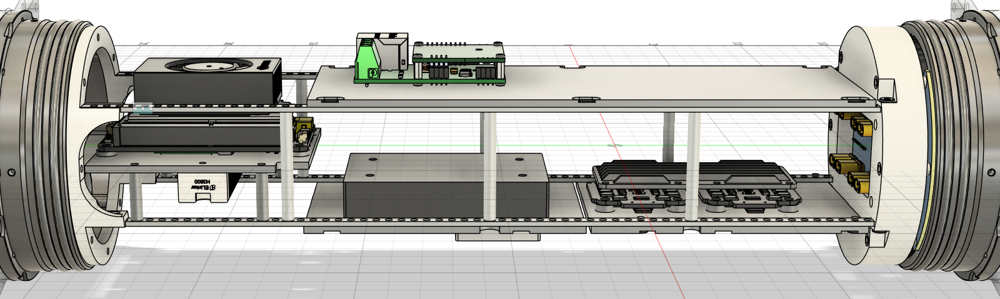
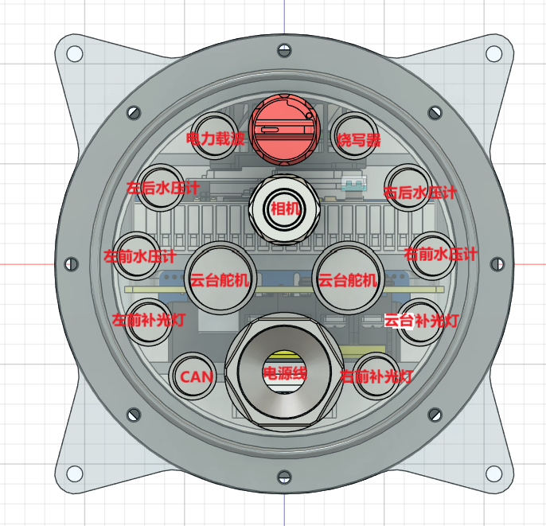
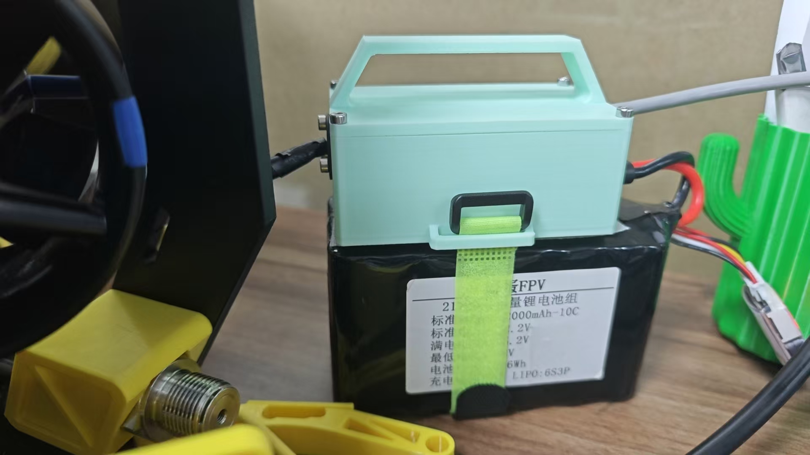
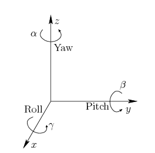

# 01 · 备料与版本说明

[教程目录](../README.zh-CN.md) · 下一步：[机架装配](02-frame.zh-CN.md)

## 先选定本次复现的配置

本仓库以主体和舱内 STEP 为位置参考，以两套 BOM 为采购入口。旧设计笔记、早期照片与当前模型存在差异时，先查[加工文件索引](../../hardware/mechanical/FILES.md)的版本状态。

| 内容 | 当前采用的配置 | 资料入口 |
| --- | --- | --- |
| 框架 | 两块相同侧板、一块顶板、两根横梁；铝合金钣金、黑色阳极氧化。制作笔记标注板厚 6 mm | [加工说明](../../hardware/mechanical/README.zh-CN.md) |
| 密封舱 | 115 系列舱管及法兰；四种孔位的铝合金 CNC 舱盖 | [本体 BOM](../../hardware/bom/BOM.csv) |
| 推进器 | 8 台 MOT-P75-170，4 CW + 4 CCW，安装编号见后续章节 | [装配 STEP](../../hardware/cad/主体装配.step?raw=true) |
| 浮力块 | PVC 发泡，密度 0.25 g/cm³，两件定制；材料耐压参数为 250 m | [浮力块模型索引](../../hardware/mechanical/FILES.md) |
| 舱内安装件 | FDM 3D 打印；IMU 外壳选装，用于遮护电路 | [舱内 BOM](../../hardware/bom/BOM-electronics.csv) |
| 机载计算机 | Jetson Orin NX，原实装使用达妙载板、JetPack 6.2 | [Jetson 配置](06-jetson.zh-CN.md) |
| 主控与传感器 | RoboMaster A、当前固件 H30 IMU、4 只水压计 | [固件说明](../../firmware/README.zh-CN.md) |
| 配重 | 200 g 铅块按需，经验 4–5 块；垫片适配 M4 安装 | [配平说明](../../hardware/mechanical/README.zh-CN.md#配平浮力) |

250 m 是浮力材料的参数，不能作为整机额定工作深度。旧笔记中的“200 m、300 m 缆、4K 相机、机械臂、可调浮力舱”包含设计目标与备选方案，现有资料不足以把它们列为整机已验证指标。早期达妙 BMI088 模块的购买记录也不代表当前固件采用该 IMU。

## 采购与加工

1. 从 [BOM.csv](../../hardware/bom/BOM.csv) / [BOM.xlsx](../../hardware/bom/BOM.xlsx?raw=true) 采购本体，从 [BOM-electronics.csv](../../hardware/bom/BOM-electronics.csv) / [Excel](../../hardware/bom/BOM-electronics.xlsx?raw=true) 采购舱内元器件。表中包含原厂或加工询价入口。
2. 按准备方式分别下单：成品、CNC、钣金、FDM、浮力材料定制。板材牌号、折弯参数、打印耗材及若干配合尺寸仍需按物料行补齐。
3. 扣除成品随件。四套法兰已包含四个端面密封圈、八个径向密封圈；舱内表 `REF-01`–`REF-04` 已在本体表计数。
4. 教程新增的紧固件数量是相应步骤的安装用量，并非整台机器人全部螺钉的完整统计。采购前核对供应商套件实际随件。

## 舱内布局与接口

下图为原设计记录中的布局：Jetson、载波通信、主控、电调和接插件转接板集中安装在舱内支架上；RS-485 模块与 IMU 位于背面。电源板在设计过程中调整过，最终装配关系请对照[舱内 STEP](../../hardware/cad/舱内装配.step.zip?raw=true)。

原信号端孔位规划见下图。图中的机械臂等接口包含预留用途，不能据此追加一整套实际未安装的设备；穿舱件的针数、键位、额定电流和接线还需逐项对照实物。

原设计中的接口清单与采购记录（供版本核对）

| 接口用途 | 原记录数量与规格 |
| --- | --- |
| 推进器 | 8 × 3 pin，1W 系列 |
| 载波通信 | 1 × 2 pin，00W 系列 |
| 相机 | 线缆经免封胶格兰头穿舱，原记录因信号问题改用穿舱件 |
| 补光灯 | 3 × 3 pin，00W 系列 |
| 水压计 | 4 × 4 pin，00W 系列 |
| 烧写接口 | 1 × 4 pin，00W 系列 |
| 机械臂与其余总线舵机 | 各预留 1 × 4 pin，1W 系列 |
| 设备舱电源 CAN | 1 × 2 pin，00W 系列 |
| 开关与电源穿线 | 两段开关标注 M10 开孔，电源穿线件标注 M16 |
| 电池舱电源 | 1 × 4 pin、35 A，原记录开孔 Ø12.6 mm |
| 电池舱 CAN/充电 | 1 × 4 pin，0W 系列；另列 M10 两段开关 |

以上是原笔记的接口规划，系列名、针数和开孔不能替代厂家图纸。原文另一处还保留“两个供电插头、一个 7 pin 充电口”的早期描述，最终采用哪套电池接口仍需核清。

原文提供的 [115 铝管商品](https://item.taobao.com/item.htm?id=761902454244&skuId=5252390285703)、[法兰商品](https://item.taobao.com/item.htm?id=755031984498)、[水密接插件商品](https://item.taobao.com/item.htm?id=619481441943&skuId=5605418253258) 和 [电池电源插座商品](https://item.taobao.com/item.htm?id=666430007928&skuId=4795428588237) 保留为历史选型入口，已去除追踪参数。下单规格以当前 BOM、最终孔图及供应商确认为准；本次未验证商品库存或重新选 SKU。

电池支撑的用途是防止电池在舱内晃动和转动；下面为原记录中的支撑实物参考，数量与电池尺寸仍需核对。

## 坐标与编号

原记录规定机器人 X 轴向前、Z 轴向上，原点为中间板中心；按右手系，Y 轴指向左侧。图中的绕轴名称为示意，装配定位及传感器方向应与所选固件配置一起核对。

推进器的物理编号、四合一电调焊盘号和固件 DShot 通道是三种不同编号，具体对照见[推进器接线](04-thrusters.zh-CN.md)。
