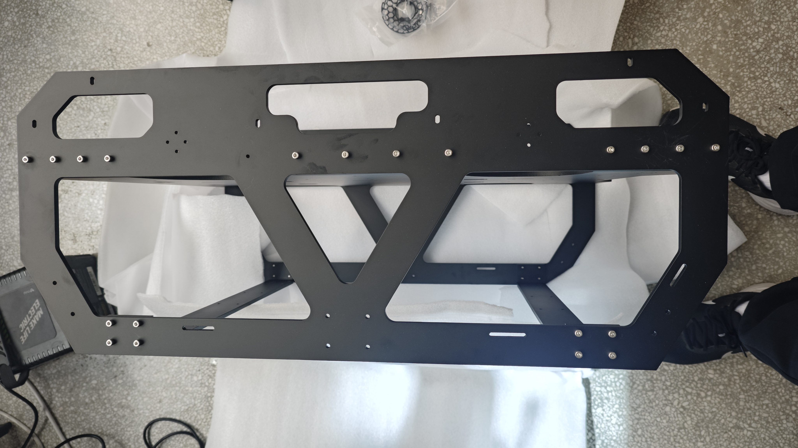
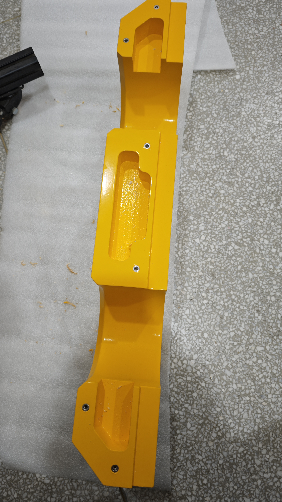
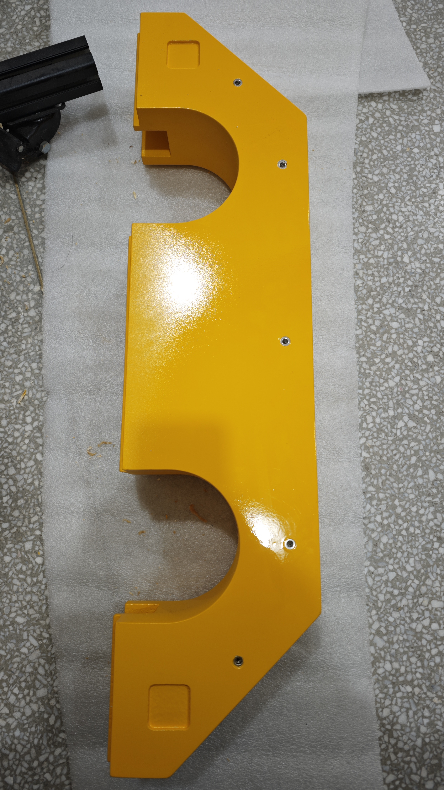
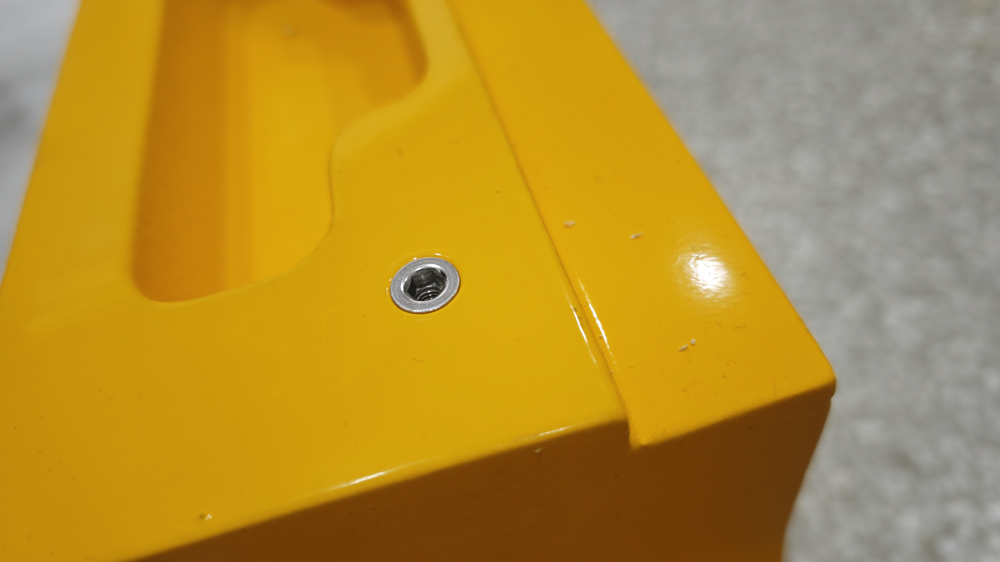
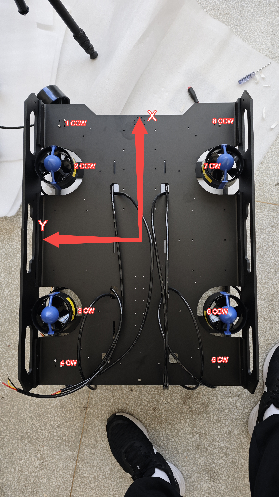
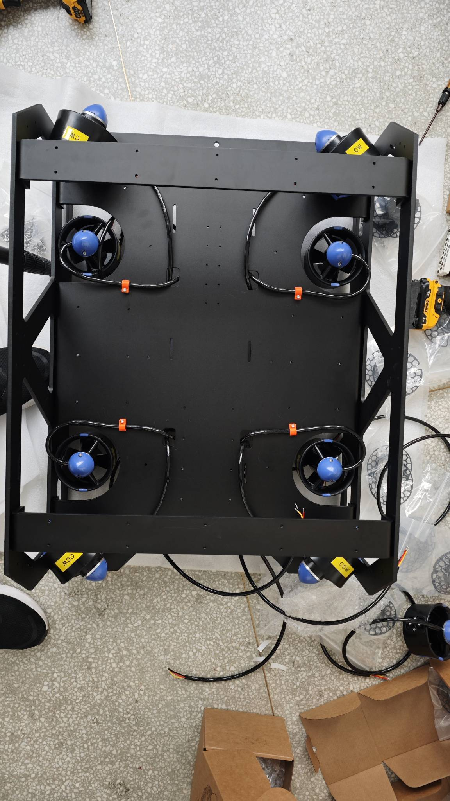
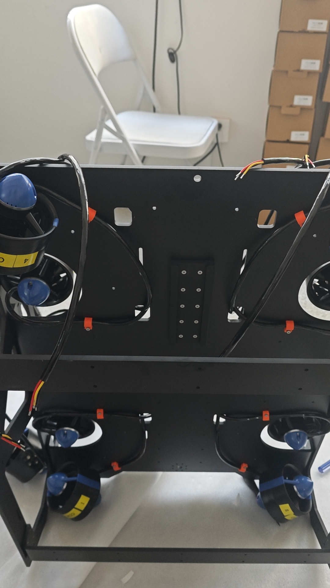

# 02 · 机架、浮力块与推进器安装

[教程目录](../README.zh-CN.md) · 上一步：[备料](01-overview.zh-CN.md) · 下一步：[电源板](03-power-board.zh-CN.md)

## 1. 组装框架

| 零件 | 安装用量 | 说明 |
| --- | --- | --- |
| 侧板 | 2 件 | 两侧相同，选用侧板 V2 |
| 顶板 | 1 件 | 与侧板、横梁均为黑色阳极氧化铝合金钣金 |
| 横梁 | 2 件 | 制作笔记标注框架板厚 6 mm；单件与总装差异见加工索引 |
| M4×12 不锈钢内六角杯头螺钉 | 42 颗 | BOM `HW-06`，仅此处框架连接用量 |

先把两根横梁与两块侧板连接，再装顶板，按总装检查方向和孔位后紧固。每根横梁两端各 4 个连接孔，共 16 颗螺钉；顶板每侧 4+5+4 个孔，两侧共 26 颗，合计 42 颗。

原照片有一处未安装螺钉，原记录说明该版孔径偏小，并计划在后续版本修正。当前尚无修正验收记录；加工前核对该孔的孔径、螺纹与相配件，不把照片中的漏装当作最终装配要求。

## 2. 安装电池舱滑座与限位角码

| 零件 | 安装用量 |
| --- | --- |
| 20×20×10 mm、M4 铝合金角码 | 2 件（`FR-06`，尺寸以实物复核） |
| 阿卡插座 / 电池舱滑座 | 1 件，核对与本体安装座的对应关系，避免重复购买 |
| M3×10 不锈钢沉头螺钉 | 10 颗（`HW-07`） |
| M4×10 不锈钢内六角杯头螺钉 | 2 颗（`HW-08`） |

阿卡插座带倒角的一端朝向电池舱插入侧，使电池舱易于滑入。检查滑入、定位与限位是否顺畅。原资料未提供角码位置特写，具体位置依照装配模型，缺失照片列在[待补资料](07-bring-up.zh-CN.md#待补资料)。

## 3. 安装浮力块预埋螺母

准备两块定制浮力块和 **22 颗 M4×10 不锈钢内外牙沉头预埋螺母**（`HW-09`）。原制作记录要求安装孔为 Ø6.5 mm；先核对选用螺母外牙尺寸和模型孔径，确认匹配后再加工，不直接把普通螺母代入。

装入后，螺母端面应低于浮力块接触面，让浮力块与框架贴合。按对应孔位固定两块浮力块，检查接触面无明显间隙。

| 浮力块内侧 | 浮力块另一侧 |
| --- | --- |
|  |  |

## 4. 安装推进器与线夹

准备 4 台 CW 和 4 台 CCW 推进器。先向供应商核对桨叶旋向与电机转向配置，并在机体与线缆两端标注电机号。仅改变三相线顺序会改变电机转向，不能替代 CW/CCW 桨叶的匹配。

下图为本机安装编号：在图示视角下，从左上角开始沿逆时针依次为 1–8。图中同时标注 CW/CCW；正反转的观察方向须与供应商定义一致。

垂直推进器较大的开口朝下，水平推进器较大的开口朝外。原照片中的电机尚未全部固定，部分朝向可能不正确，以总装和编号图为准。

| 底部布线参考 | 穿过预留孔的走线参考 |
| --- | --- |
|  |  |

原教程写明每台电机配一个 3D 打印线夹，共 **8 个**。当前 STEP 的电机线夹本体定义合计 4 件，另有压板等零件，尚未建立“8 个线夹”与各 CAD 零件的完整对应。BOM 保留 STEP 实例数量并注明此差异，不额外重复计入 8 套。

先按实际路径试装线缆和线夹，再测量裁线。原资料把 1/8、2/7、3/6、4/5 号分为四组，但未填写长度，当前不提供推测的裁线尺寸。线缆穿过框架预留孔到上层，保持维护余量，检查不接触桨叶、不被板边挤压。

## 5. 安装其余部件与配平

按 CAD 安装主舱、电池舱、相机、灯和水压计支架。相机、灯和水压计固定件采用 FDM；光轴夹按成品整套采购；套管用于限制线夹沿光轴平移。当前资料还缺这些部件逐步安装的近照与完整紧固件明细。

全机装好实际载荷后再调整配重。未加配重时平台为正浮力，200 g 铅块经验用量为 4–5 块，以垫片缩减铅块孔径后用 M4 螺钉固定。安装位置和实际数量按水中配平结果调整，见[配平说明](../../hardware/mechanical/README.zh-CN.md#配平浮力)。
