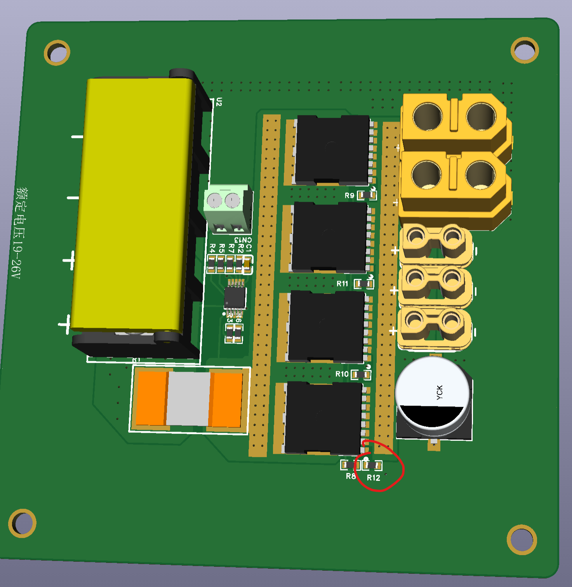

# 03 · 电源管理板焊接

[教程目录](../README.zh-CN.md) · 上一步：[机架](02-frame.zh-CN.md) · 下一步：[推进器接线](04-thrusters.zh-CN.md)

本章对应舱内 BOM 的 `EC-07`，即 LM5069 电源缓启动与过流保护板。

## 资料与版本核对

| 文件 | 用途 |
| --- | --- |
| [立创开源工程](https://oshwhub.com/gan_ju/lm5069-dian-yuan-huan-qi-dong-yu-guo-liu-bao-hu-ban) | 查看原理图与 PCB，确认当前设计版本 |
| [PowerBoard.zip](../../hardware/pcb/PowerBoard.zip?raw=true) | Gerber 与钻孔文件，用于裸板制作 |
| [交互式 BOM](../../hardware/pcb/assembly/interactive-bom.html?raw=true) | 下载后用浏览器打开，按位号、型号、封装定位元件 |

GitHub 文件页不会直接运行交互式 HTML；使用 **Download raw file** 保存到本地再打开。HTML 来自原附件 `InteractiveBOM_PCB2_1_2026-4-8 (1).html`，已按字节保留。该文件、当前立创工程和制板 ZIP 是否同版，尚待作者确认。

### R12 的装配状态尚不能直接下结论

原制作记录写明“R12 不要焊接”，又注明错误设计“已修改”；随附交互式 BOM 仍列有 **R12、10 kΩ、R0603、C25804**，装配属性为 `is_mount: true`。因此，这两份记录对 R12 的处理存在冲突。

焊接前先核对手上的 PCB 版本、对应原理图及 R12 的修订记录。不要把旧版的“不焊”自动应用到全部新版，也不要仅按 HTML 自动贴装 R12。仓库保留原附件，没有擅自改动其元件数据。

## 焊接顺序

1. 按交互式 BOM 清点元件、封装及数量，对照 PCB 正反面定位。
2. 原实装建议正面贴片：电阻、控制芯片、电容、采样电阻、MOSFET 和铜排。
3. 铜排对应图中两条竖向焊盘，原记录要求截取为与焊盘匹配的长度。铜排截面与连接要求未给出，需按最终板版补齐。
4. 剩余元件及反面连接件手焊，核对极性、方向和焊点。
5. 通电前核查电源输入输出极性及短路，使用与最终原理图一致的电压和限流条件进行独立板级验证，再接入整机。

原记录提供的[焊接演示视频](https://www.bilibili.com/video/BV1B4QoBQEiu/)可作为操作参考。具体过流阈值、缓启动波形及验收条件尚未提供，本章不填入推测数值。

交互式 BOM 用于辅助手工装联，不能替代贴片厂要求的采购 BOM、坐标文件和明确的 DNP 清单。送贴片前应从确认的同版工程导出这些文件。
