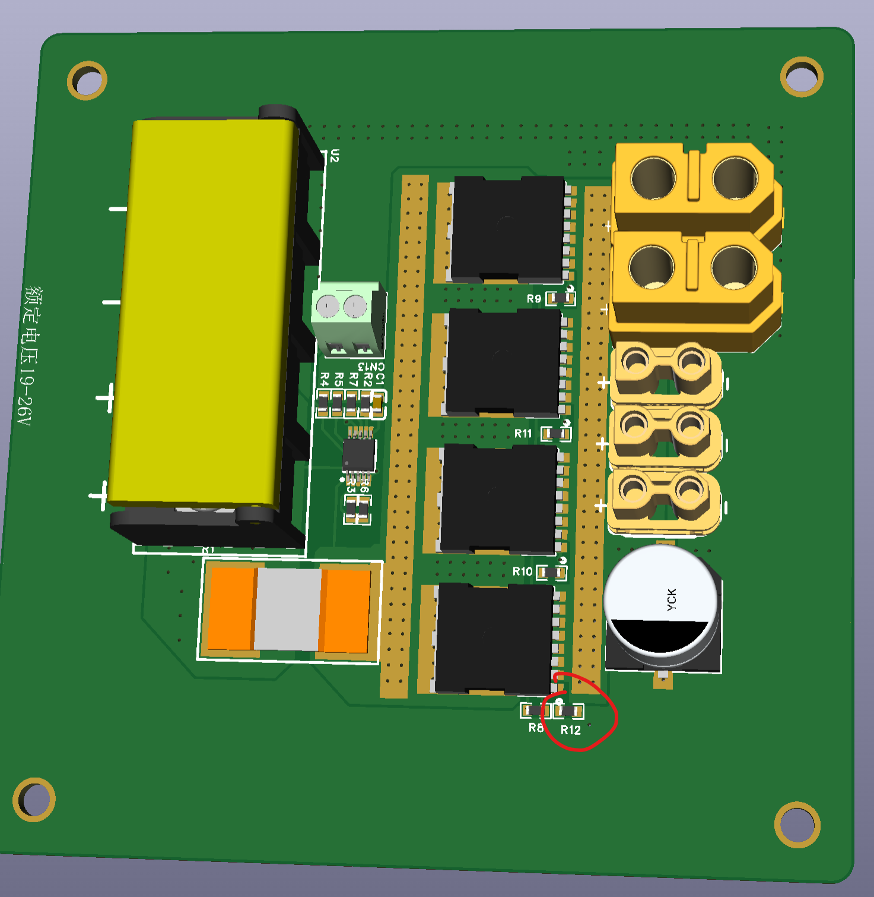

# 03 · 电源管理板焊接

[教程目录](../README.zh-CN.md) · 上一步：[机架](02-frame.zh-CN.md) · 下一步：[推进器接线](04-thrusters.zh-CN.md)

本章对应舱内 BOM 的 `EC-07`，即 LM5069 电源缓启动与过流保护板。

## 资料与版本核对

| 文件 | 用途 |
| --- | --- |
| [立创开源工程](https://oshwhub.com/gan_ju/lm5069-dian-yuan-huan-qi-dong-yu-guo-liu-bao-hu-ban) | 查看原理图与 PCB，确认当前设计版本 |
| [PowerBoard.zip](../../hardware/pcb/PowerBoard.zip?raw=true) | Gerber 与钻孔文件，用于裸板制作 |
| [旧版交互式 BOM](../../hardware/pcb/assembly/interactive-bom.html?raw=true) | 历史装联参考；含已从最终工程删除的 R12，不能直接作为最终版本贴装表 |

GitHub 文件页不会直接运行交互式 HTML；使用 **Download raw file** 保存到本地再打开。HTML 来自原附件 `InteractiveBOM_PCB2_1_2026-4-8 (1).html`，已按字节保留。最终 EDA 工程已经删除 R12，现有 HTML 仍含它；制板 ZIP 与最终工程的对应及最新装联导出文件仍需同步。

### 最终 EDA 工程已删除 R12

作者于 2026-11-18 确认最终 EDA 工程已删除 **R12**，因此最终版不装配该元件，不再作为待决焊接项。原制作记录中的“R12 不要焊接”及旧 HTML 的 **R12、10 kΩ、R0603、C25804、`is_mount: true`** 仅保留为历史版本记录。

装联使用最终工程的同版导出文件；不能按旧 HTML 重新加装 R12。仓库保留原附件，没有把删除单行后的旧 HTML 冒充完整的最终版本。

使用[EC-07 版本核对单](../../hardware/pcb/assembly/revision-checklist.zh-CN.md)记录 PCB、Gerber、装联数据和 R12 的对应关系。输入输出端、各路负载及返回线见[系统供电核验图](../../hardware/electrical/system-wiring.zh-CN.md#供电总图)。作者已确认原称“24V”的供电均为电池直供，随电量波动；EC-07 的具体接入路径、限流和线径仍待补，不将其画成 24V 稳压器。

## 焊接顺序

1. 按最终工程导出的同版 BOM 清点元件、封装及数量，对照 PCB 正反面定位；R12 已删除，旧交互式 BOM 仅作历史定位参考。
2. 原实装建议正面贴片：电阻、控制芯片、电容、采样电阻、MOSFET 和铜排。
3. 铜排对应图中两条竖向焊盘，原记录要求截取为与焊盘匹配的长度。铜排截面与连接要求未给出，需按最终板版补齐。
4. 剩余元件及反面连接件手焊，核对极性、方向和焊点。
5. 通电前核查电源输入输出极性及短路，使用与最终原理图一致的电压和限流条件进行独立板级验证，再接入整机。

原记录提供的[焊接演示视频](https://www.bilibili.com/video/BV1B4QoBQEiu/)可作为操作参考。具体过流阈值、缓启动波形及验收条件尚未提供，本章不填入推测数值。

交互式 BOM 用于辅助手工装联，不能替代贴片厂要求的采购 BOM、坐标文件和明确的 DNP 清单。送贴片前应从确认的同版工程导出这些文件。
