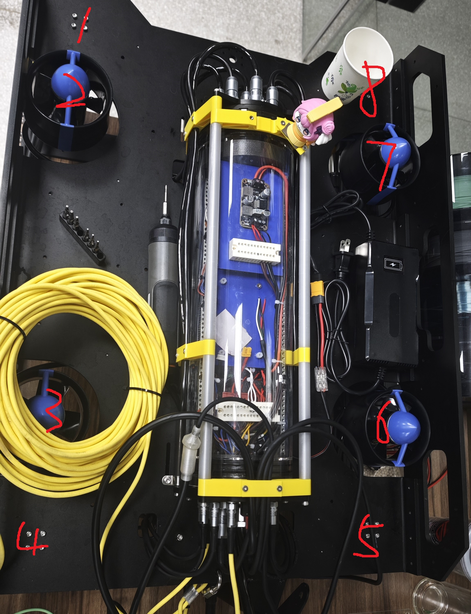
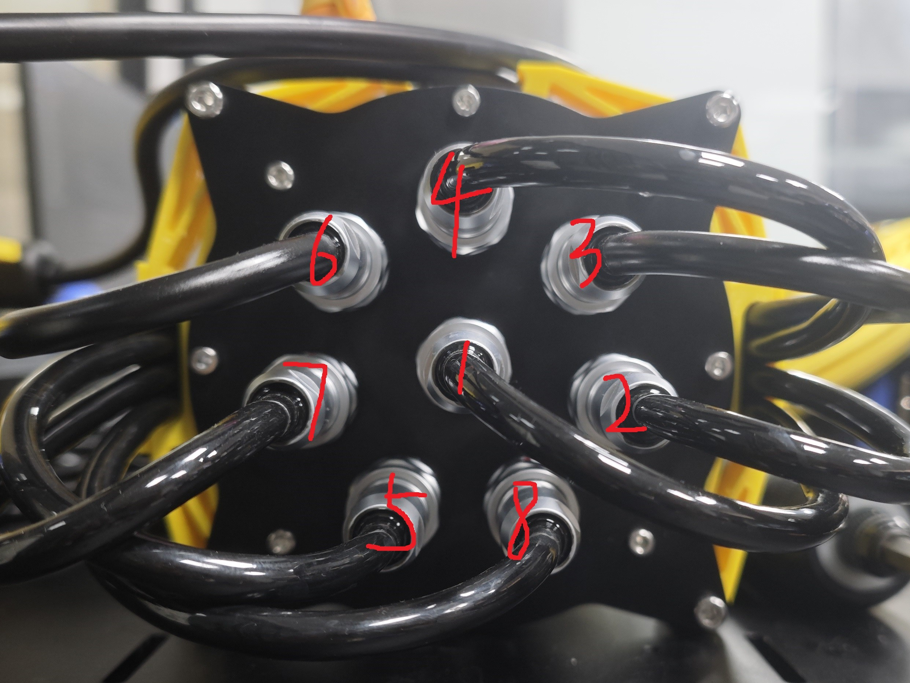
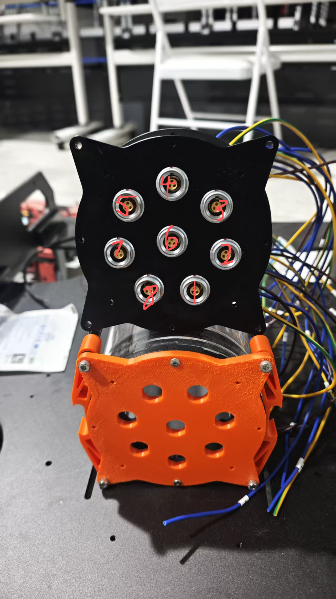
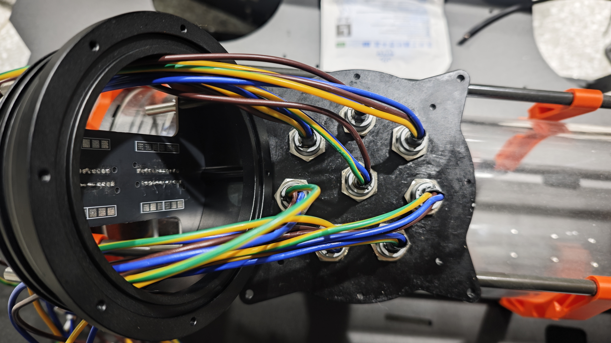
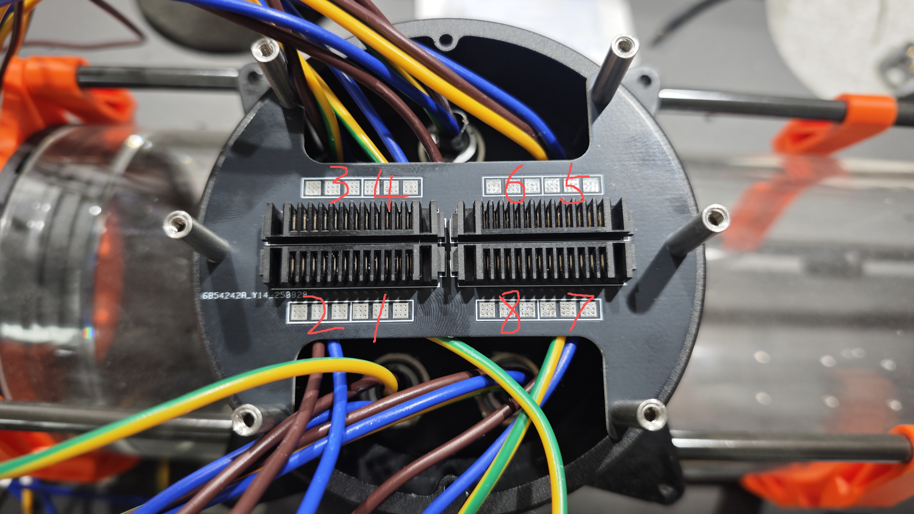
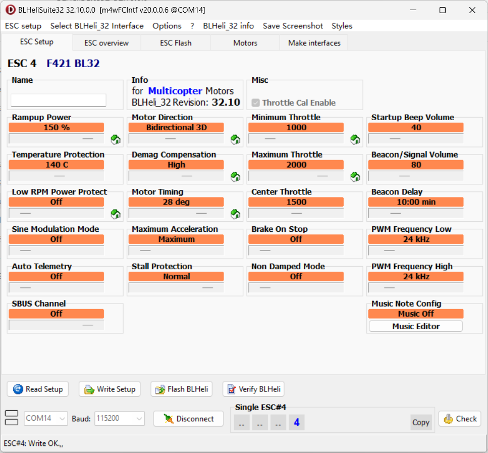
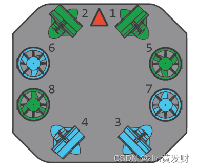

# 04 · 推进器与电调接线

[教程目录](../README.zh-CN.md) · 上一步：[电源板](03-power-board.zh-CN.md) · 下一步：[水压计](05-pressure-sensors.zh-CN.md)

先完成[推进器安装编号](02-frame.zh-CN.md#4-安装推进器与线夹)，再连接舱外线缆、穿舱件、转接板和电调。下面的编号均为本机记录。

## 1. 对照舱外线号

| 整机上的编号 | 电机端穿舱线缆编号 |
| --- | --- |
|  |  |

## 2. 连接两块四合一电调

靠近 RoboMaster A 主控板的一块为 **电调 1**，靠外侧的一块为 **电调 2**。以下焊盘号来自原设计记录；最后一列为当前 `SUB` 的 DShot 通道索引，与焊盘号含义不同。

| 物理电机号 | 四合一电调 | 该电调电机焊盘号 | SUB 的 DShot 通道 |
| --- | --- | --- | --- |
| M1 | 2 | 2 | 3 |
| M2 | 1 | 2 | 7 |
| M3 | 1 | 4 | 5 |
| M4 | 2 | 1 | 4 |
| M5 | 2 | 3 | 2 |
| M6 | 1 | 3 | 6 |
| M7 | 1 | 1 | 8 |
| M8 | 2 | 4 | 1 |

固件对应位置：[TaskSUB.cpp](../../firmware/SUB/Interface/Examples/TaskSUB.cpp)。不要将焊盘号直接填入固件通道映射。

电调对插板背面：M3、M4、M5、M6 的线从上侧走，其余从下侧走。

每台推进器三根相线须接到同一输出组；三相线顺序会影响转向，焊接完成后逐路核对实际旋向。原文“顺序无要求”仅可理解为没有固定线色次序，不能省略转向检查。

原记录将 RM-A 信号标识 **Z–S** 对应到 M1–M8。现有图片不足以替代完整的连接器针脚表；接线时结合板上丝印和所选固件核对，尚缺可逐针检查的最终线束表。

## 3. 核对电调配置

原方案采用支持 DShot 与 3D 双向运行的四合一电调，并建议按 30 A 级别选型；实际品牌、硬件版本及额定电流需以采购记录确认。原实装的 BLHeli32 配置截图如下，可放大查看。

[下载原附 BLHeliSuite32 32.10.0.0](../reference/BLHeliSuite32_32.10.0.0.zip?raw=true)。这是原记录随附的第三方工具，不代表当前任意电调都适配它。先核对电调固件族和版本，再读回配置；不能把 BLHeli32 截图中的全部参数照搬到 BlueJay 或 AM32。

配置后逐一确认：物理电机号、信号通道、双向模式、实际旋向与 CW/CCW 桨叶匹配。调试中先验证控制量与通道，再按推进器厂家允许的试验条件进行低输出转向检查。

原笔记中的通用桨向示意（编号不用于本机）

原记录注明这是网络示意图，仅以蓝色表示 CW、绿色表示 CCW。图上的电机编号与 FinsROV-Heavy 不同，不用于本机布线。保留原图水印；原始文章链接未随导出提供。

