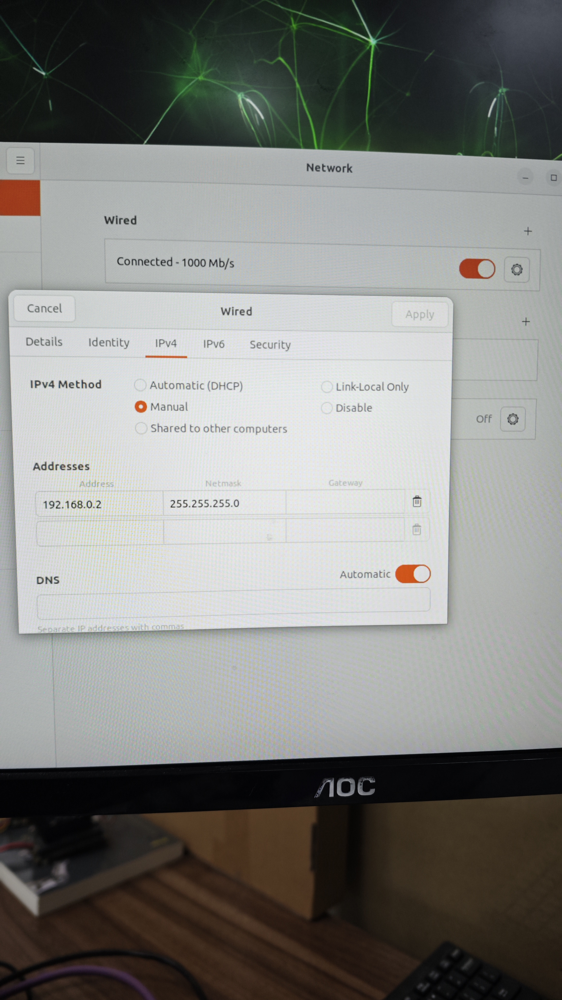
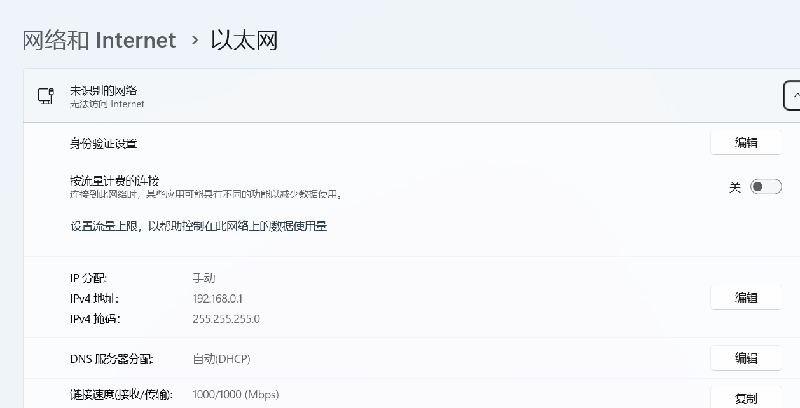
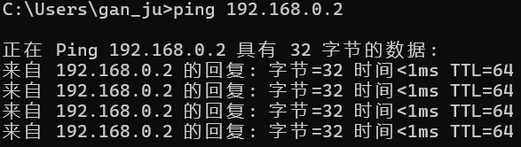
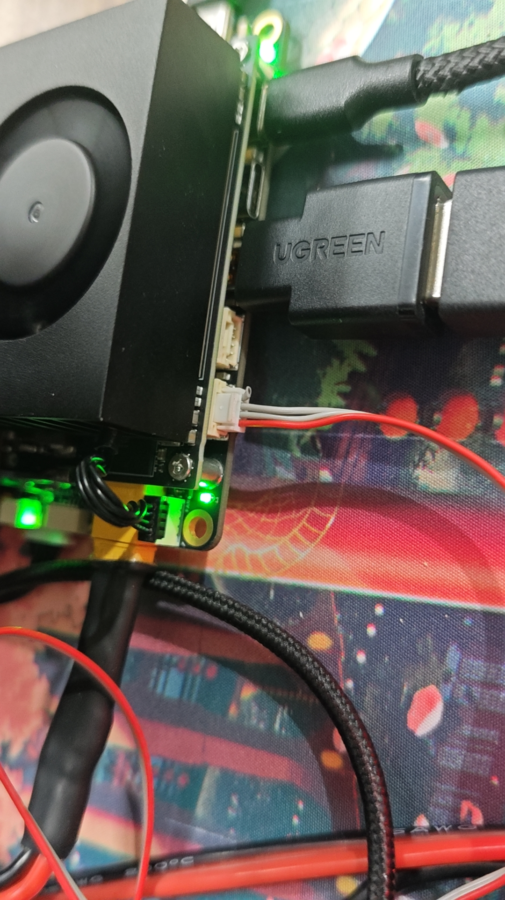
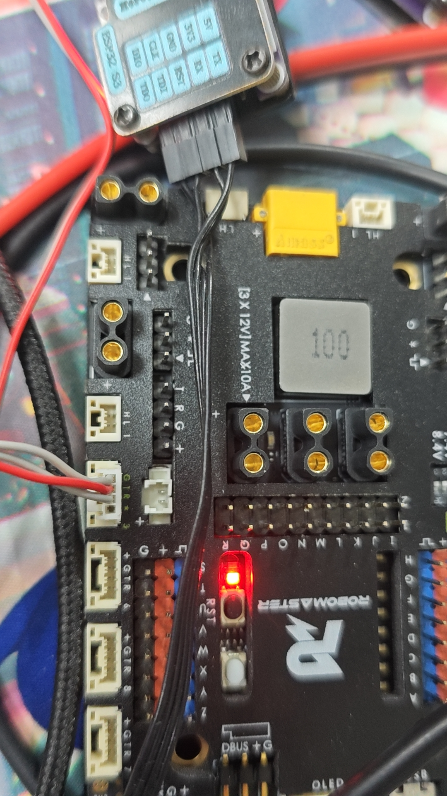
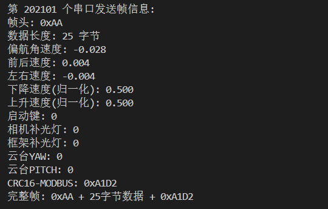
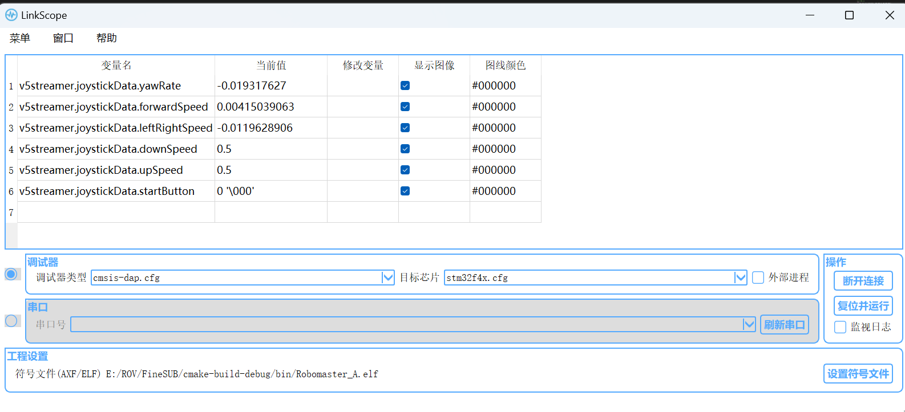

# 06 · Jetson 配置与视频传输

[教程目录](../README.zh-CN.md) · 上一步：[水压计](05-pressure-sensors.zh-CN.md) · 下一步：[联调检查](07-bring-up.zh-CN.md)

本章以原实装的 **Jetson Orin NX + 达妙 V2.X 载板 + JetPack 6.2** 为基准，配合仓库中的 **SUB 正常操控固件**。Orin Nano 可参考网络与串口步骤，但没有 NVENC，需要切换为 CPU 视频编码；实际帧率要在本机验证。[NVIDIA 说明](https://docs.nvidia.com/jetson/archives/r36.4.3/DeveloperGuide/SD/Multimedia/SoftwareEncodeInOrinNano.html)

原记录没有完整刷机步骤。先按照载板对应版本完成系统安装并确认串口、网口和 USB 可用。[载板原附说明书](<../reference/达妙科技DM-ORIN NX V2.X使用说明书V1.0.pdf?raw=true>) · [载板厂商仓库](https://gitee.com/kit-miao/orin-board)

## 1. 先用以太网直连

| 设备 | IPv4 地址 | 子网掩码 |
| --- | --- | --- |
| Windows 地面站 | 192.168.0.1 | 255.255.255.0 |
| Jetson | 192.168.0.2 | 255.255.255.0 |

在两端的有线网络设置中填写静态地址。直接连接的测试链路不依赖默认网关；下载依赖所用的网络连接需另行配置。先用网线直连地面站与 Jetson，确认后再接入电力载波链路。

| Jetson 网络设置参考 | Windows 网络设置参考 |
| --- | --- |
|  |  |

Windows 终端执行：

```powershell
ping 192.168.0.2
```



若使用其他网段，同时修改两个 Python 脚本中的目标 IP。UDP 端口为：Jetson 接收手柄 `12345`、PC 接收遥测 `54321`、PC 接收视频 `5600`。按实际网络配置允许这些端口。

## 2. 连接 USB 相机与 UART

相机接载板 USB-C。原实装串口为载板最下方的 U1，对应 `/dev/ttyTHS1`；具体引脚须对照手中载板版本的说明书。

Jetson 连接 RoboMaster A 的 **UART3**。GH1.25 四针线中去掉 **5 V 供电线**，只保留信号和公共地：

| Jetson | RoboMaster A |
| --- | --- |
| GND | GND |
| TX | RX |
| RX | TX |

不要仅根据导线颜色或插头外形判断针序；重新排针后逐线检查。

| Jetson 侧 | RoboMaster A 侧 |
| --- | --- |
|  |  |

| 取出供电线与调整线序 | 三线连接参考 |
| --- | --- |
|  |  |

## 3. 安装依赖并配置设备访问

以下命令在 Jetson 上执行，假设已将本仓库放在 `~/FinsROV-Heavy`。示例使用系统 Python 3；已有虚拟环境也可使用，但需要在启动服务中填写其 Python 绝对路径。

```bash
sudo apt update
sudo apt install python3-serial v4l-utils gstreamer1.0-tools \
  gstreamer1.0-plugins-base gstreamer1.0-plugins-good \
  gstreamer1.0-plugins-bad gstreamer1.0-plugins-ugly gstreamer1.0-libav
python3 -c "import serial; print(serial.__version__)"
gst-inspect-1.0 --version
ls -l /dev/ttyTHS1 /dev/video0
```

NX 硬件编码需系统中存在 `nvvidconv`、`nvv4l2h264enc`。先运行 `gst-inspect-1.0 nvv4l2h264enc` 检查；若缺失，按当前 JetPack/L4T 版本安装匹配的 NVIDIA 插件，不混装不同系统版本的包。[NVIDIA GStreamer 安装说明](https://docs.nvidia.com/jetson/archives/r36.4.3/DeveloperGuide/SD/Multimedia/AcceleratedGstreamer.html)

如果 `ls -l` 显示串口属于 `dialout`、相机属于 `video`，将实际运行用户加入相应组，注销并重新登录后检查权限：

```bash
sudo usermod -aG dialout,video "$USER"
# 重新登录后执行
id
test -r /dev/ttyTHS1 && test -w /dev/ttyTHS1 && echo "UART access OK"
```

若属组不同，按设备实际属组和载板配置处理。无需对所有串口执行 `chmod 777`。串口不存在时先检查载板设备树和接口配置；串口被占用时确认没有其他调试程序或控制台在使用它。

## 4. 单独运行控制转发

按[固件教程](../../firmware/README.zh-CN.md)编译并烧录 `SUB`。本章脚本使用 115200、28 字节下发帧；**惯性里程计实验固件是 460800、52 字节下发帧，不能直接使用本脚本**。

如果已安装自启服务，调试前先停止，避免串口和 UDP 端口被重复占用：

```bash
sudo systemctl stop streamer.service
cd ~/FinsROV-Heavy/software/jetson
python3 V5StreamerNX.py
```

尚未安装服务时跳过第一行。脚本启动后应打印串口成功打开及 UDP 监听端口。

原 Windows 手柄上位机尚未随资料提供，因此完整操控验证还需要该程序或兼容的发送端。包格式、端口与串口帧说明见[脚本说明](../../software/jetson/README.md)。当前脚本的映射为：

| 输入数组 | 输出控制量 |
| --- | --- |
| `axes[0]` 取负 | 偏航 |
| `axes[3]` 取负 | 前后 |
| `axes[2]` 取负 | 左右 |
| `axes[4]`、`axes[5]` 从 −1…1 归一化为 0…1 | 下降、上升；实际手柄通常对应扳机，需核对输入枚举 |
| `buttons[6]` | 启动键 |
| `buttons[0]`、`buttons[1]` | `camFillLight`、`frameFillLight` 字段 |
| `hat[0]`、`hat[1]` | 云台 yaw、pitch |

原文描述 A/B 分别控制相机灯和框架灯，但当前 `SUB/TaskSUB.cpp` 只使用 `camFillLight` 切换三路灯，未实现 `frameFillLight` 单独控制。这里按已发布代码说明，不承诺两个独立灯组的行为。



调试器保持连接时，可通过 LinkScope 或已有监视工具查看 `v5streamer.joystickData` 字段，核对对应摇杆变化。原实机监视截图：



上行遥测目前按串口读到的数据块直接发 UDP，**一个 UDP 包不保证就是一帧遥测**。接收端要按所选固件重新组帧并校验；本脚本没有实现丢包恢复。

## 5. 单独验证视频

先检查相机实际支持的格式和分辨率：

```bash
v4l2-ctl --device=/dev/video0 --list-formats-ext
```

编辑 `GStreamerTest.py` 顶部参数，默认 MJPEG、1280×480、30 fps、4 Mbit/s、目标 `192.168.0.1:5600`。NX 默认 `USE_NVENC = True`；Nano 设为 `False`，并按实际性能降低分辨率或帧率。MJPEG 通过 `jpegdec` 软件解码，NX 路径使用硬件 H.264 编码。

Jetson 上运行：

```bash
cd ~/FinsROV-Heavy/software/jetson
python3 GStreamerTest.py
```

在装有 GStreamer 的地面站终端中运行下面的一行命令，可不依赖 Windows 上位机先接收视频：

```bash
gst-launch-1.0 -v udpsrc port=5600 caps="application/x-rtp, media=(string)video, clock-rate=(int)90000, encoding-name=(string)H264, payload=(int)96" ! rtph264depay ! h264parse ! avdec_h264 ! videoconvert ! autovideosink
```

没有图像时依次检查相机枚举、格式支持、目标 IP、UDP 端口和日志中的缺失插件。停止测试用 Ctrl+C。

## 6. 安装开机自启

先分别确认两个脚本能运行，再试启动脚本：

```bash
cd ~/FinsROV-Heavy/software/jetson
bash StreamerStart.sh
```

停止手动运行后，编辑随附的 [streamer.service](../../software/jetson/streamer.service)，把 `User`、`WorkingDirectory`、`ExecStart` 中的 `fins` 和路径改成实际值。使用 Conda/venv 时，把 `PYTHON_BIN` 改为相应环境的 Python 绝对路径，不需要在服务内执行 `conda activate`。

```bash
sudo install -m 644 streamer.service /etc/systemd/system/streamer.service
sudo systemd-analyze verify /etc/systemd/system/streamer.service
sudo systemctl daemon-reload
sudo systemctl enable --now streamer.service
systemctl status streamer.service
journalctl -u streamer.service -f
```

服务随网络上线启动，任一子程序意外退出时停止另一程序并以失败状态退出，由 systemd 在 10 秒后重启。停止服务会清理该服务所属进程。重启 Jetson 后重新确认服务状态、视频和控制量均正常，再切换到载波链路复测。[systemd 项目文档](https://systemd.io/)

本次整理完成了脚本的离线检查，未在实际 Jetson、相机或机器人上运行；重启、断线恢复和整机控制行为仍需实机验收。
