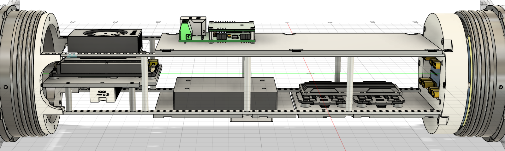

# 08 · 舱内装配与线束固定

[教程目录](../README.zh-CN.md) · [制造版本清单](../../hardware/mechanical/manufacturing-release.zh-CN.md) · 下一步：[密封、检漏与配平](09-sealing-trim.zh-CN.md)

本章把现有 BOM、模型和 V5 笔记组织成装配工作顺序，供试装和记录使用。它尚未经过一次完整实机复做验证；缺少的板卡位置近照、紧固件和安装参数在每步列出。实际空间与朝向以本次选定的[舱内 STEP](../../hardware/cad/舱内装配.step.zip?raw=true)为参考，不能按下方历史布局图直接确定安装孔。

## 1. 把零件与模型对应起来

设备舱采用本体 BOM 的 EN-01、EN-03、EN-07、EN-08；舱内表的 REF-01～04 只是引用这些零件，不再采购一套。

| 装配组 | 舱内 BOM / 用量 | 试装前核对 |
| --- | --- | --- |
| 骨架与固定环 | MTI-01 固定环 1 件、MTI-08 螺母条 4 根 | 轨向、固定环位置、螺母条端孔与牙规；螺母条独立制造图尚缺 |
| 电源支撑 | MTI-07 电源底板 1 件、EC-07 电源板 1 块 | PCB 实际版本、支撑孔、元件高度；先处理 R12 冲突 |
| 计算机支撑 | MTI-06 NX 固定板 1 件、EC-02/03 载板与模组 | 实际载板版本、风扇/散热空间、网口/USB/电源插拔方向 |
| 主控与上层支撑 | MTI-03 主控固定板、MTI-05 上板，各 1 件 | EC-01 安装孔、接口与螺柱位置；不能仅按板名推定上下朝向 |
| 电调与相线对接 | MTI-04 电调固定板、MTI-02 对插板固定件，各 1 件；EC-05 电调 2 块 | EC-08/09 对插公母板位置、配插方向、螺钉与焊点间隙 |
| IMU/总线/载波 | 按舱内 BOM 对应器件 | 实际 IMU 型号、安装方向及原点；原设计图中的背面布置只作参考 |
| 支柱与螺钉 | FI-01～05 按 BOM | 长度、端型、有效牙长和安装位置；CAD 未包含全部紧固件 |

七种 MTI-01～07 支撑件均已确认采用 FDM，但打印参数未定。完成试装后在[装配记录](../../hardware/mechanical/build-record.zh-CN.md)逐件记录实际工艺和照片。

原笔记称 RS-485 模块与 IMU 位于背面，电源板当时仍在调整。不能用这张图覆盖当前 CAD 或实际接线。两块电调在原记录中以“靠近 A 板”为 1 号、“靠边”为 2 号；试装时给板卡贴号，再对照[电机连接表](04-thrusters.zh-CN.md)。

## 2. 舱外完成结构试装

1. 用 MTI-01、MTI-08 和各安装板对照总装建立骨架，先核对孔位与插接空间。螺母条孔距/牙规未确认时先完成尺寸记录，不靠强行旋入螺钉修正孔位。
2. 按实际板卡逐组试装电源、NX、主控、电调与对插板。记录每个支柱属于 FI-01～04 中哪一类，补齐模型中未统计的螺钉；不能把“合计 20 根支柱”当作所有位置可以互换。
3. 装上实际散热器、风扇与所有需要的插头。检查元件/焊点不触碰紧固件，板卡不靠螺钉拉弯才能贴合，插头能够插拔；这些是本轮试装检查项，尚无实测间隙数值。
4. 在未装舱管时完成板卡正反面和端盖内侧照片，照片中标出设备号、接口号与固定点。需要以后拆开的插头留可见标签。

此顺序用于减少封舱后的返工；最终层叠高度、位置和螺钉长度仍须以实装记录锁定。

## 3. 布线与穿舱端对应

接线定义使用[设备舱接口表](../../hardware/electrical/equipment-wiring.zh-CN.md)和[电池舱接口表](../../hardware/electrical/battery-wiring.zh-CN.md)。本章只规定机械路径的记录方法，不另设针序、供电或总线连接。

| 线束组 | 必须保持的识别 | 机械路径检查 |
| --- | --- | --- |
| 8 路推进器相线 | 电机 M1～M8、J-M01～08、电调号及输出组 | 电机端穿舱件到对插板有明确去向；相线不被舱盖或支架压住 |
| 主电源与电池 CAN | 主供电和充电/CAN 接口分开标记 | 插头可维护，电池滑入/取出不依靠拉线操作；四芯主电源分配仍待核 |
| 压力、灯、云台与 PLC | 沿用现有 J-PRS、J-LGT、J-EXT、J-PLC 编号 | 每根线的两端可追溯；不根据相同 4 针定义推断共用总线 |
| NX、主控、IMU 与辅助模块 | 两端接口和设备名 | USB/网线/串口插头可插拔，风扇周围无遮挡；IMU 安装方向与软件配置对应 |
| 相机与烧写口 | 对照接口表中已确认/待确认状态 | 相机线缆穿舱件、烧写口位置和维护路径留照片；未确认针序不制作线束 |

外部推进器线缆沿框架预留孔进入上层，原照片见[机架章节](02-frame.zh-CN.md)。光轴套管用于限制线夹平移，其数量与轴向位置还需实机确认。固定后检查线缆不进入推进器运动区域、不过度折弯、不被板边夹压；弯曲半径与固定要求采用实际线缆/接插件厂商要求。

先按最终路径试装，再测量裁线。对 1/8、2/7、3/6、4/5 四组分别记录：测量起点、终点、固定点路径长度、两端端接预留和裁线长度。同组电机仍逐根记录，不能因编号分组而假设等长。模型没有软线长度，不能据 STEP 尺寸补出裁线表。

## 4. 电池舱与整机固定

电池支撑 MT-08/09 用于限制电池晃动和旋转；MT-10 的法兰填充件与支撑关系尚待确认。先按实际电池外形试装并记录数量、位置，检查线束和开关连接不会在装入舱管时被夹压。

电池面板按作者确认的三个孔配置，见[电池接线说明](../../hardware/electrical/battery-wiring.zh-CN.md)。四芯主供电插座与四针充电/CAN 插座不是同一个针序。当前不根据旧设计笔记增加第二个供电口或 7 针充电口。

主舱、电池舱、相机、灯和压力固定件先按总装定位，再检查舱座夹持与拆装路径。阿卡滑座与 EN-04 成品舱座是否同一件/改制件、限位角码位置仍需实物确认；不要再按独立模型多计一套舱座。

## 5. 装舱管前的检查点

- 本次制造版本和待核项已记录；装配孔不靠扩孔或更换螺钉临时绕过未确认问题。
- 板卡号、外部接口号、线束两端标签与电气表一致；完成所需的通断/极性检查并保存记录。
- 原有台架通信和控制检查在可观察状态下完成，结果使用[联调清单](07-bring-up.zh-CN.md)记录。
- 插头、焊点和线束不顶住舱管；滑入/抽出操作不拉扯线束。记录实际维护余量，不套用通用长度。
- 舱内正反面、两端盖内侧、螺柱和线束固定点已有照片，缺失部件与未确认项仍保持可见。

满足本步后进入[密封、检漏与配平](09-sealing-trim.zh-CN.md)。机械试装完成不代表已通过密封或耐压验证。
