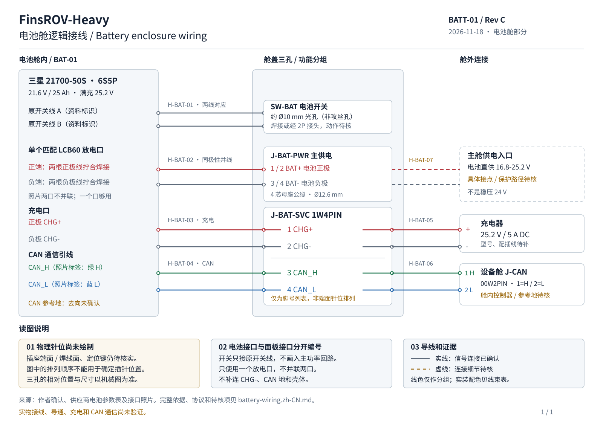
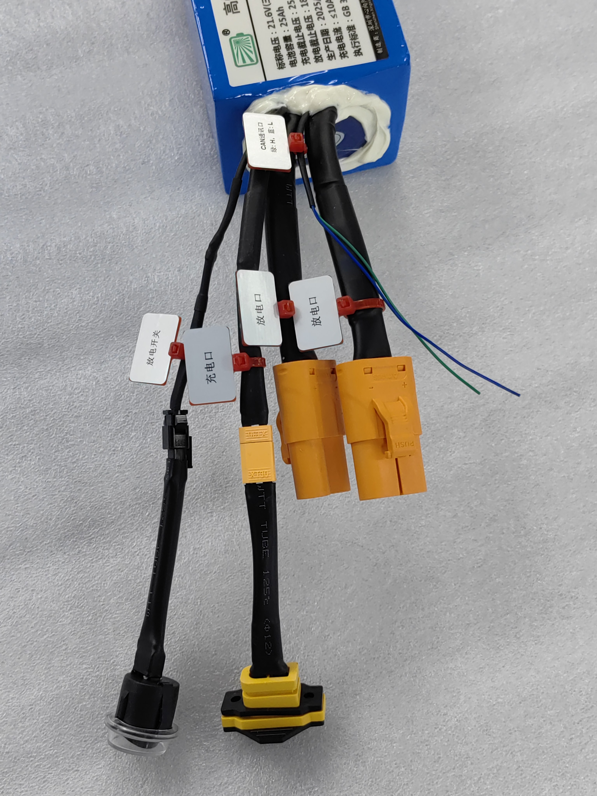

# 电池舱接线

[电气资料目录](README.zh-CN.md) · [SVG 图](diagrams/battery-wiring.svg) · [PDF 图](diagrams/battery-wiring.pdf) · [接口/线束 Excel](battery-wiring.xlsx)

版本：BATT-01 Rev B，2026-11-17。依据为作者实装说明、电池供应商参数表和原始实物照片。Rev B 补充设备舱 CAN 口的对应关系。已确认的信号关系与未核的物理针位分别记录，图纸不作为最终焊线端面图。

## 电池总成 BAT-01

| 项目 | 参数 | 依据或适用范围 |
| --- | --- | --- |
| 电芯与组合 | 三星 21700-50S 三元锂电芯，6S5P | 参数表第 1、2、6 项；3D 示意图标有 6S5P |
| 标称电压 / 容量 | 21.6 V / 25 Ah | 参数表及实物铭牌 |
| 标称能量 | 540 Wh（21.6 V × 25 Ah 计算值） | 不代表可用能量或实测续航 |
| 工作电压范围 | 16.8–25.2 V | 参数表第 3 项 |
| 充电截止电压 | 25.2 V | 参数表规格栏、实物铭牌和作者所述充电器一致 |
| 放电截止电压 | 标准 18 V；最低 16.8 V | 供应商参数，不作为本次设定的上位机报警阈值 |
| 充电电流 | 标准 ≤5 A；最大 ≤10 A | 实机充电器由作者确认为 25.2 V、5 A DC |
| 放电电流 | 最大持续 60 A；峰值 90 A（1 s） | 电池包参数，不代表整机线束、插座或配电板额定电流 |
| 电池外包络 / 重量 | ≤295 × 67 × 77 mm；约 2.6 kg | 供应商参数；照片的宽/高命名方向不同，安装时以实际朝向核对 |
| 温度范围 | 充电 0～45 °C；放电 −20～60 °C；储存 −20～45 °C | 供应商参数 |

原参数表第 4 项备注写成“6 串 × 4.2 V = 54.6 V”，属于算式错误。此处采用正确结果 **25.2 V**，原 PDF 保持不变以便追溯。

## 舱盖上的三个孔

作者确认面板共三个孔；以下是功能清单，**不表示三孔的相对位置**。孔间距、开孔公差和密封面仍由匹配版本的机械图确定。

| 接线编号 | 装配件 | 开孔与选型 | 已确认连接 |
| --- | --- | --- | --- |
| `SW-BAT` | 电池开关 | 作者称“M10 光滑圆孔”，记录为约 Ø10 mm 安装光孔，不改写为 M10 攻丝孔；开关完整型号待补 | 开关两根线分别接电池原有的两根开关线，焊接或经 2P 接头连接 |
| `J-BAT-PWR` | 主供电插座 | Ø12.6 mm 光孔；采购规格“4 芯母座公缆” | 接电池放电回路并向主舱供电；4 芯逐针功能尚未提供 |
| `J-BAT-SVC` | 充电 / CAN 插座 | **1W4PIN**；开孔尺寸、配对线缆型号和公母待补 | 1 脚充电正，2 脚充电负，3 脚 CAN_H，4 脚 CAN_L |

主供电插座的[作者指定商品和 SKU](https://item.taobao.com/item.htm?id=666430007928&skuId=4795428588237)保留供复购。商品页面本次无法直接读取；“4 芯母座公缆”来自作者确认，不能由这几个字推出每芯电流、针序或并联方式。

旧笔记里的“0W 充电/CAN 口”和“两个供电插头、一个 7 pin 充电口”不再作为当前**舱盖面板**配置。电池包照片本身仍有两组标注为“放电口”的引线，它们如何接入唯一的四芯面板供电口尚未明确。

## 逐路接线

### 开关回路 H-BAT-01

`BAT-01` 原开关线对接 `SW-BAT` 两根引线。可选择焊接或一套 2P 接头，端接处分别绝缘并固定线束。表中的 `SW-A` / `SW-B` 只用于区分两根线，不是厂家脚号；实际对应、开关动作类型及开关对充电/CAN 的影响仍待核实。

该开关画在电池原有的开关回路中。现有资料没有支持把它改画为串入主放电正极的大电流开关。

### 主供电回路 H-BAT-02

参数表写电池放电口为 LCB60 母头，出线 12 cm。实物照片中有两组“放电口”标签，本次先标作 `BAT-01/D1` 和 `BAT-01/D2`，仅作为资料区分，不表示厂家端口名或二者内部关系。

`D1/D2` 到 `J-BAT-PWR` 四芯的关系用虚线表示。**未指定 1/2 脚为正、3/4 脚为负，也未假定两组放电口并联。** 需补齐四针分配和主舱端接法后，才能拆成逐根生产线号。线束表中的 `W-BAT-03` 是待展开的回路，不是一根四芯已核线缆。

### 充电回路 H-BAT-03

| 面板针号 | 信号 | 舱内端 | 舱外端 |
| --- | --- | --- | --- |
| `J-BAT-SVC:1` | `CHG+` | 电池充电口正极 | 充电器 DC 正极 |
| `J-BAT-SVC:2` | `CHG-` | 电池充电口负极 | 充电器 DC 负极 |

充电器输出由作者确认为 **25.2 V / 5 A DC**。电池参数表记载充电引线为 XT30 转 XT60E-F，电池端 12 cm、转接端 6 cm；这些是供应商原线长度，不是舱内改线的裁线长度。充电器品牌型号、限流/充电控制方式及面板转接线仍待补。

### CAN 回路 H-BAT-04

| 面板针号 | 信号 | 电池侧实物标签 | 参数表文字 |
| --- | --- | --- | --- |
| `J-BAT-SVC:3` | `CAN_H` | 绿线 H | 红线 CAN-H |
| `J-BAT-SVC:4` | `CAN_L` | 蓝线 L | 黑线 CAN-L |
| 未分配 | CAN 参考地 | 照片未显示可确认的第三根地线 | 黄线 GND，HY2.0-3P 母头 |

绿 H / 蓝 L 来自照片上的标签，优先作为这份实物资料的辨识依据；最终线束仍需按该批电池标识核对。**不能把绿色或蓝色写成其他批次电池的通用配色。** 未确认 CAN 参考地与充电负极、放电负极或壳体的关系，图中不补连这些节点。

CAN_H/L 用于读取电池状态。作者进一步确认其连接设备舱左下角的 **J-CAN（00W2PIN）**：电池舱 `J-BAT-SVC:3 → J-CAN:1（CAN_H）`，`:4 → J-CAN:2（CAN_L）`。设备舱内最终接哪个 CAN 控制器仍待补，见[设备舱接线](equipment-wiring.zh-CN.md)。图中分开表示充电器与设备舱 CAN 口，不表示充电器具有 CAN 接口，也不承诺充电与 CAN 可同时接入；外缆是否采用分线转接仍待确认。协议摘录见 [CAN 说明](battery-can.zh-CN.md)。

## 实物参考与来源

原件及其 SHA-256 见[附件索引](references/battery/README.md)。电池包的供货线长、裸电芯排布尺寸与整机线束的裁线尺寸分别记录。图中导线颜色只用于区分信号类型，实际配色以接口/线束表和确认后的实物为准。

## 集中待核项

| 编号 | 缺少的信息 | 对图纸的影响 |
| --- | --- | --- |
| BATT-Q1 | 主供电 4 芯分别接什么；照片中 D1/D2 两组放电口各如何使用；到主舱插座的对应 | 完成 H-BAT-02 逐针接线，确认有无并联、分路或备用 |
| BATT-Q2 | `J-BAT-PWR`、`J-BAT-SVC` 配插面/焊线面、定位键与针号关系；SVC 具体料号和孔径 | 绘制物理端面图，避免正反面镜像；当前四脚表只表示脚号与信号 |
| BATT-Q3 | 设备舱 J-CAN 两针对应已确认；尚缺舱内 CAN 控制器、参考地、实际波特率、板号和终端电阻；外缆是否分线 | 完成剩余总线拓扑和报文读取配置 |
| BATT-Q4 | 开关型号、动作类型、两线对应、供货原开关是否移除；开关关闭时各接口行为 | 完成开关状态表与启停说明 |
| BATT-Q5 | 充电器型号/铭牌及充电控制方式；供电与充电插座每芯额定电流、线径、实装线长、密封附件 | 完成采购和线束制造资料；5 A 为当前充电器参数，不扩大到 10 A |

资料核对时先记录针号、信号和测量基准，再补长度及配色。现阶段未进行实机导通测试、充电试验或 CAN 采集，待核项不得按图中的绘制顺序推定。
