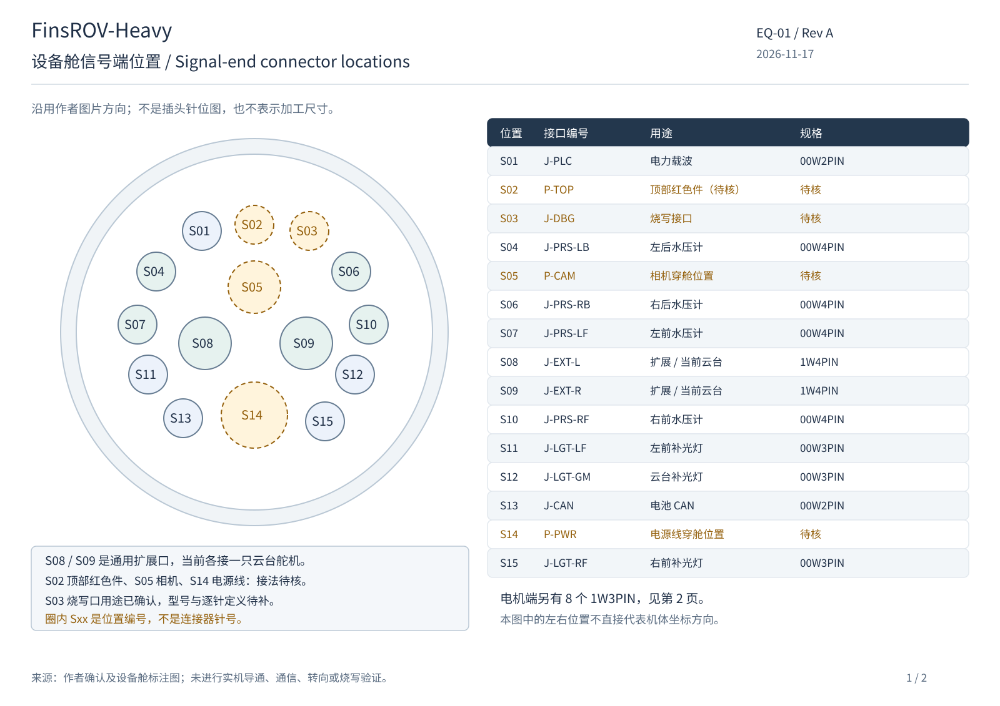
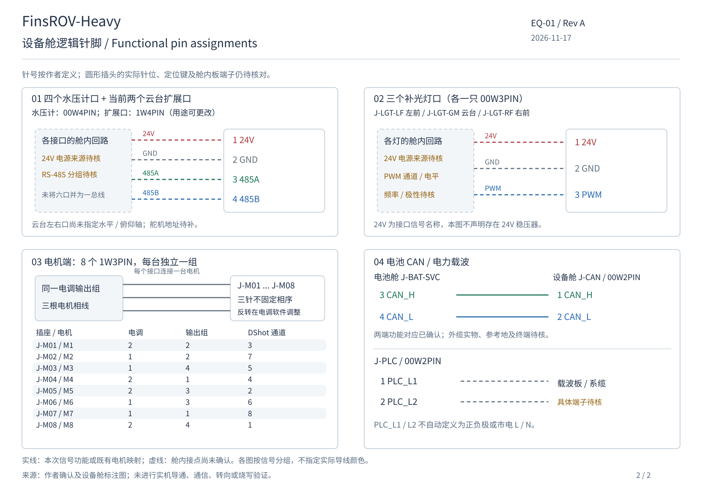

# 设备舱插座与接线

[电气资料目录](README.zh-CN.md) · [PDF 图册](diagrams/equipment-wiring.pdf) · [接口 Excel](equipment-wiring.xlsx) · [接口清单 CSV](equipment-connectors.csv) · [逐针 CSV](equipment-pinout.csv)

版本：EQ-01 Rev A，2026-11-17。作者确认了设备舱两端的接口用途和针脚定义，并提供信号端标注图。本文按该图的上下左右定位，不将其直接认定为舱外插合面或舱内焊线面；针号与定位键的物理关系仍需实物或厂家端面图确认。

## 信号端位置图

[作者原始标注图](references/equipment/signal-panel-reference.png)原样保存，校验值见 [manifest.json](references/equipment/manifest.json)。上图是接口位置示意，不是可加工的孔位图；圆圈只代表接口位置，不表示连接器内插针排布。顶部红色件没有文字标注，暂保留为 `P-TOP`，不据外形补接线。

| 图号 | 接口编号 | 用途 | 规格与逻辑针号 |
| --- | --- | --- | --- |
| S01 | `J-PLC` | 电力载波 | 00W2PIN；1=PLC_L1，2=PLC_L2 |
| S02 | `P-TOP` | 顶部红色件，功能待核 | CAD 有开关；与本位置对应及接线待核 |
| S03 | `J-DBG` | 固件烧写 | 当前型号及针序待核；历史规划为 00W4PIN |
| S04 | `J-PRS-LB` | 左后水压计 | 00W4PIN；1=24V，2=GND，3=485A，4=485B |
| S05 | `P-CAM` | 相机穿舱位置 | 类型、型号和针序待核 |
| S06 | `J-PRS-RB` | 右后水压计 | 00W4PIN；1=24V，2=GND，3=485A，4=485B |
| S07 | `J-PRS-LF` | 左前水压计 | 00W4PIN；1=24V，2=GND，3=485A，4=485B |
| S08 | `J-EXT-L` | 通用扩展口，当前连接云台舵机 | 1W4PIN；1=24V，2=GND，3=485A，4=485B |
| S09 | `J-EXT-R` | 通用扩展口，当前连接云台舵机 | 1W4PIN；1=24V，2=GND，3=485A，4=485B |
| S10 | `J-PRS-RF` | 右前水压计 | 00W4PIN；1=24V，2=GND，3=485A，4=485B |
| S11 | `J-LGT-LF` | 左前补光灯 | 00W3PIN；1=24V，2=GND，3=PWM |
| S12 | `J-LGT-GM` | 云台补光灯 | 00W3PIN；1=24V，2=GND，3=PWM |
| S13 | `J-CAN` | 电池状态 CAN | 00W2PIN；1=CAN_H，2=CAN_L |
| S14 | `P-PWR` | 电源线穿舱位置 | 类型、型号和内部接法待核 |
| S15 | `J-LGT-RF` | 右前补光灯 | 00W3PIN；1=24V，2=GND，3=PWM |

“左前、左后、右前、右后”沿用作者的设备名称；Sxx 的左右只指所给图片。`J-EXT-L/R` 表示图中位置，尚未对应到云台水平轴/俯仰轴。

## 逐类接线

### 电机端：8 个 1W3PIN

每个插座连接一台推进器的三根相线，编号为 `J-M01`～`J-M08`，按对应电机 M1～M8 定义。每个插座的三根线接同一电调输出组；**三针没有固定相序要求**。若实测转向相反，可在对应电调的配置软件中调整方向，再核对实际旋向。

本文没有把插座针号 1/2/3 固定成 U/V/W，也没有把电机相线画成 24V/GND/控制信号。M1～M8 的环向孔位仍按[原电机线号图](../../docs/build/04-thrusters.zh-CN.md#1-对照舱外线号)识别，不从本页信号端图片推定。

| 插座 | 电机 | 电调 | 输出组/焊盘号 | SUB DShot 通道 |
| --- | --- | --- | --- | --- |
| J-M01 | M1 | 2 | 2 | 3 |
| J-M02 | M2 | 1 | 2 | 7 |
| J-M03 | M3 | 1 | 4 | 5 |
| J-M04 | M4 | 2 | 1 | 4 |
| J-M05 | M5 | 2 | 3 | 2 |
| J-M06 | M6 | 1 | 3 | 6 |
| J-M07 | M7 | 1 | 1 | 8 |
| J-M08 | M8 | 2 | 4 | 1 |

后三列沿用[现有实装记录和 SUB 映射](../../docs/build/04-thrusters.zh-CN.md)。本次新增穿舱接口定义，不改变电机控制映射或固件。电调对插板的逐针网络仍待补。

### 云台扩展口与水压计口

这两类接口当前均为 `1=24V、2=GND、3=485A、4=485B`，但连接器系列不同。中央两口是 **1W4PIN 通用扩展口**，本机各接一只 RS-485 舵机组成相机云台；其用途不永久限定为云台，也不提前把左/右口指定为水平/俯仰轴。

四个水压计使用 **00W4PIN**。沿用已有压力位置地址：左前 0x01、左后 0x02、右后 0x03、右前 0x04，配置方法见[水压计教程](../../docs/build/05-pressure-sensors.zh-CN.md)。舵机地址、串口参数及控制接口尚未给出。

针脚功能相同不代表六个接口都在同一条 RS-485 总线上；本图不把云台总线与压力总线直接并接。舱内转换器、端子和终端电阻须在后续总线图中明确。

### 灯、PLC 与电池 CAN

三只灯各用一个 **00W3PIN**，`1=24V、2=GND、3=PWM`。PWM 电平、频率、有效极性及三个灯口对应的主控通道待核。本次只记录接口定义，不据此声称现有软件可分别控制三盏灯。

PLC 为 **00W2PIN**，`1=PLC_L1、2=PLC_L2`。这两个信号名表示载波线对，未据此定义正负极、岸端供电或市电 L/N；其与载波板和系缆的接法另行核对。

电池 CAN 为 **00W2PIN**，功能对应如下：

| 电池舱 J-BAT-SVC | 信号 | 设备舱 J-CAN |
| --- | --- | --- |
| 3 | CAN_H | 1 |
| 4 | CAN_L | 2 |

该表是两端功能对应，实际外缆、插头端面、参考地、终端电阻和舱内 CAN 控制器尚未核验。充电器仍接电池舱 J-BAT-SVC 的 1/2 脚；不将它们接入设备舱的两芯 CAN 口。见[电池接线说明](battery-wiring.zh-CN.md)。

以上 **24V 是作者给出的接口信号名称**。是否来自电池直供、受保护母线或稳压输出，尚未提供；不能据名称认定有独立 24V 稳压器，也不能把电池 16.8～25.2 V 范围自动套用到所有接口。各处 GND 与外壳、CAN 参考地的具体关系仍待配电图确认。

### 烧写接口

图右上方 `J-DBG` 用于安装铝合金舱体后从舱外烧写固件。若采用亚克力舱体，作者给出的另一种方案是在舱内安装无线烧写器。

烧写器型号、实际接口系列/芯数以及引脚定义尚未给出。历史文档曾写 00W4PIN，但本次不把它提升为已确认规格，也不默认填写 SWDIO、SWCLK、GND、VREF 或电源。无线方案仍需提供具体设备、连接与测试记录。

## 与采购表的关系

- `IF-01` 共 10 只已细分为 **1W3PIN ×8 + 1W4PIN ×2**，本页不额外增加采购数量。
- `IF-02` 的 CAD 总数为 10 只；本次明确 **00W4PIN ×4 + 00W3PIN ×3 + 00W2PIN ×2 = 9 只**。剩余一只与烧写口的对应及型号仍待确认，不凭总数自动确定烧写口针数。
- 相机、电源线穿舱件及顶部红色件列为图中位置，未据图片重算原 BOM 的穿线件或开关数量。

## 集中待核项

| 编号 | 尚缺内容 |
| --- | --- |
| EQ-Q1 | 烧写器型号、插座系列/针数与逐针定义；是否需要引出复位、参考电压或供电 |
| EQ-Q2 | 相机与电源线穿舱件的型号/接法；顶部红色件用途和与 CAD 开关的对应 |
| EQ-Q3 | 插合面/焊线面、定位键、插针编号和配插头；电机端孔位与 M1～M8 的实物核对 |
| EQ-Q4 | 各 24V 支路供电来源、GND/壳体关系、线径/长度、每芯电流和防水附件 |
| EQ-Q5 | 云台两轴对应、舵机型号/地址/波特率、RS-485 分组与转换器；灯 PWM 参数及通道 |
| EQ-Q6 | CAN 舱内控制器/针脚、参考地/终端/波特率；PLC 板端子和系缆对应 |

本次仅整理文档，未进行实机导通、转向、烧写或通信测试。
