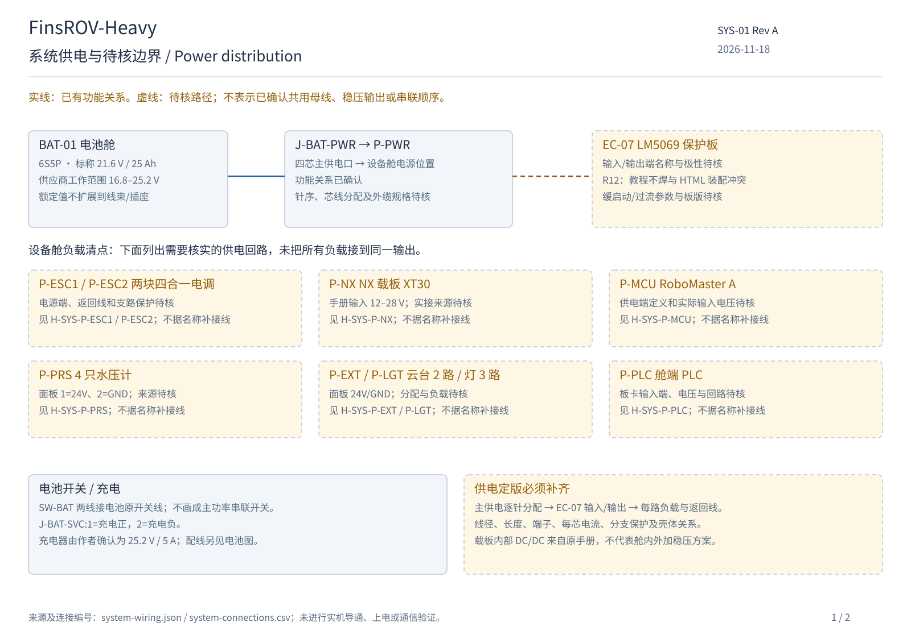
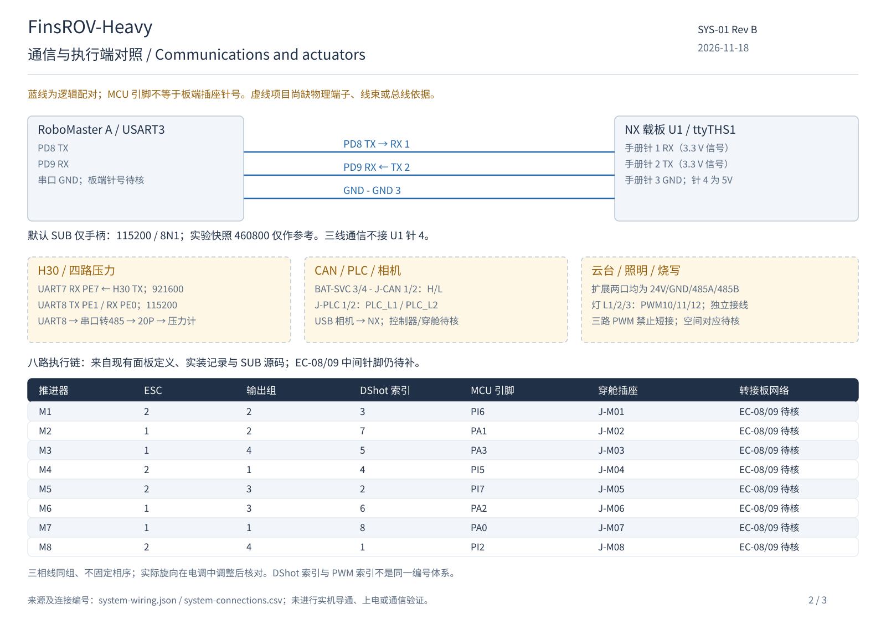
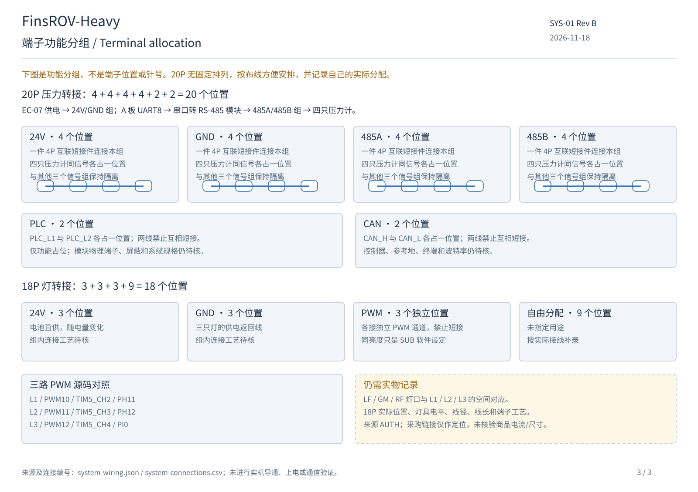

# 系统接线与核验台账

[电气目录](README.zh-CN.md) · [三页 PDF](diagrams/system-wiring.pdf) · [连接与线束 Excel](system-wiring.xlsx) · [连接 CSV](system-connections.csv) · [MCU 对照 CSV](mcu-signal-map.csv) · [线束 CSV](system-harness.csv) · [端子分组 CSV](system-terminal-allocation.csv)

版本 **SYS-01 Rev B，2026-11-18**。本资料把电池舱、设备舱面板、舱内板卡和固件接口连到同一份核验台账。本次按[作者确认记录](../../docs/development/author-confirmations.zh-CN.md)更新，保留 74 条连接、17 条 MCU 对照及 44 组线束编号，另增 10 组端子功能分配。现有资料仍不能直接用于全部线束裁线或确定整机供电额定值。

## 依据如何读取

| 依据状态 | 含义 | 不代表什么 |
| --- | --- | --- |
| 功能确认 | 作者确认的接口功能，或现有实装记录中的设备对应 | 插合面针位、线色、长度、端子或导通已实测 |
| 逻辑核对 | 手册、配置和教程相互核对得到的接口配对 | 实装载板版本和线束已经核验 |
| 源码推导 | 从固定 SUB 快照的任务、BSP 和外设配置追踪得到 | 板端插座针号或硬件已经实际接线 |
| 待核 | 缺少足以确定连接的资料 | 可按图中排列自行补线 |

连接编号 `W-SYS-*` 标识功能连接记录；`H-SYS-*` 是供后续实测登记使用的线束分组，不是新增采购数量。有些记录覆盖线对或三相组，不能把行数当作导线根数。新台账不替代现有 `H-BAT-*`，电池舱内部仍以[电池线束表](battery-harness.csv)为准。

## 供电总图

四芯主供电定义已由作者确认：**1、2 为电池正极，3、4 为电池负极**。同极性的两根线剥开、拧合，分别焊到一个匹配的 LCB60 插头正、负极。照片虽有两个放电口，作者确认一个足够使用，不需要并联两个放电口；这不代替焊点、每芯电流或温升验证。

- 图纸所有 `24V` 标签均为**电池直供**，随电量波动；供应商电池工作范围为 **16.8–25.2 V**，并非稳压 24 V。该范围不代表已验证各负载的电压适配。
- 四只压力计的电源直接从 **EC-07 电源控制板**取出，经 20P 的 24V/GND 功能组分配；板端物理针号与支路保护仍待核。
- 达妙 DM-ORIN NX V2.X 手册的电源树标注 **XT30 输入 12–28 V**，这是载板规格，并非实装线束的供电来源证明。
- `SW-BAT` 接电池原开关线；开关功能没有被改画成主功率回路串联开关。
- 主供电每芯电流、返回线、EC-07 输入与其余负载保护路径、外壳连接，均须依据最终工程和实物补齐。
- 作者确认最终 EDA 工程已删除 **R12**，该问题已关闭；旧 HTML 作为历史资料保留，见[电源板定版核对单](../pcb/assembly/revision-checklist.zh-CN.md)。

## MCU 与 NX 的三线串口

原教程指定载板 **U1 / `/dev/ttyTHS1`**。载板手册纸面第 4 页（PDF 第 6 页）的两路串口均给出相同的接头脚功能：1=RX、2=TX、3=GND、4=5V；串口信号为 3.3 V 电平。手册接头图可用于核对观察方向，不能凭本页表格推定线色或把焊线面直接当插合面。

| 起点 | 逻辑终点 | 证据与限制 |
| --- | --- | --- |
| MCU USART3 TX，PD8 | NX U1 RX，手册针 1 | `usart.c` 与载板手册交叉核对；MCU 板端插座针号待核 |
| NX U1 TX，手册针 2 | MCU USART3 RX，PD9 | 同上 |
| NX U1 GND，手册针 3 | MCU 串口 GND | 三线通信参考地；实际 MCU 针号待核 |
| NX U1 5V，手册针 4 | 本三线通信不连接 | 不将这根 5V 线接到 MCU 电源或信号脚 |

先确认实装载板与手册对应，再核查 TX/RX 交叉关系。当前默认发布 **SUB，仅手柄控制，115200、8N1**。现有惯性里程计实验快照的 **460800、8N1** 仅作历史对照，不是默认部署模式；物理引脚相同不表示帧协议兼容。原手册见[附件](../../docs/reference/达妙科技DM-ORIN%20NX%20V2.X使用说明书V1.0.pdf)。

## 传感器、灯光与辅助接口

| 子系统 | 本轮补齐的依据 | 实物接线仍缺什么 |
| --- | --- | --- |
| H30 IMU | SUB 从 UART7 RX **PE7** 接收，配置 921600、8N1；TX **PE8** 仅证实外设配置 | 实装型号、电平、供电、设备端针号。没有证据要求额外连接 TX PE8 |
| 四只压力计 | A 板 UART8 → 串口转 RS-485 模块 → 20P → 四只压力计；TX **PE1**、RX **PE0**，115200、8N1，地址 01–04；EC-07 直接取电 | 转换模块型号、电平、方向控制、物理端子、终端和线束分支。PE0/PE1 不能直接写成 A/B |
| 云台 | 两个扩展口的面板定义已确认 | 两轴对应、舵机型号与地址、总线分组。SUB 的 AU25S500 实例被注释，不能把示例地址当实装地址 |
| 三路灯 | 18P 的三路 PWM 分别接独立通道；SUB L1/L2/L3 使用 PWM **10/11/12**，对应 TIM5_CH2/3/4、**PH11/PH12/PI0** | L1/L2/L3 与 LF/GM/RF 的空间对应、灯具电平/极性及电源组连接工艺。驱动设 50 Hz、1100–1900 µs，属于源码配置，未实测 |
| 电池 CAN | 电池 SVC 3/4 对应设备舱 CAN 1/2 | 设备舱接 NX 还是 MCU、波特率、参考地、终端与外缆。载板存在 CAN 口不能证明本机接到该口 |
| PLC / USB 相机 | 原教程的以太网载波与 USB 视频链路 | PLC 电源、板端针号、系缆芯数和屏蔽；相机实际 USB 口及穿舱方式 |
| 烧写口 | J-DBG 的用途已确认 | 烧写器、系列/芯数、SWD 或其他实际针序、复位/VREF/供电需求 |

三路灯的 PWM **分别接线、禁止短接**。SUB 当前任务通过同一个 `camFillLight` 状态同时切换三路灯，尚不表示 UI 支持分别调节亮度。云台与压力口虽然都有 485A/B，也不能据此把六个插座并为同一条总线。

## 20P / 18P 端子功能分组

[独立分组表](system-terminal-allocation.csv)与 Excel 第四页签按功能统计占位，**不是端子针号**。20P 没有固定顺序要求，复刻者可按布线方便安排，记录自己实际使用的位置；不需要等待原机端子顺序定版。

| 端子排 | 功能分配 | 组内连接 |
| --- | --- | --- |
| 20P | 24V、GND、485A、485B 各 4P，共 16P | 每个同信号 4P 用一件 4P 互联短接件，四组相互独立，不跨组短接 |
| 20P 剩余 4P | PLC 两线 2P、CAN 两线 2P | PLC_L1/L2 各占一位置，CAN_H/L 各占一位置；不同信号禁止短接 |
| 18P | 24V、GND、PWM 各 3P，共 9P | 三路 PWM 各接独立通道；24V/GND 组的端接工艺待核，不推定短接件型号 |
| 18P 剩余 9P | 自由分配 | 未指定用途，按实物补录 |

4P 互联短接件的[用户指定采购链接](https://item.taobao.com/item.htm?id=720074181347)只作为物料定位；本次未读取到商品页面，未核验尺寸、电流或兼容性。所有分组均未进行实际导通测试。

## 推进器完整对应

八路 DShot 对应见[MCU 对照表](mcu-signal-map.csv)和图册第 2 页。映射由三个独立层次串联得到：实装电机/电调输出组 → `TaskSUB.cpp` 的 M1–M8 → `Robomaster_A.h` 的 DShot GPIO 数组。不要将 DShot 索引当成 PWM 索引。

`EC-08/09` 对插公母板的逐针网络仍未获得。现阶段能确认每个电机接哪个电调输出组，但不能补猜对插板排针号。三相线须在同一输出组内，三针不固定相序；实际旋向由电调配置及桨叶布置共同核对。

## 线束制作与验证记录

[线束表](system-harness.csv)按功能分组预留线径、成品长度、测量起止点、线色/端子和验证记录。未提供的数据写为“待测/待定义”，没有使用 0 代表未知长度。补录时遵循以下顺序：

1. 先给两端接头拍摄带定位键的端面与焊线面，注明观察方向，并核对配对插头。
2. 按 `W-SYS-*` 逐条补设备端针号、舱内端子及中间转接关系，确认后再确定裁线与端接预留。
3. 在断电且负载适当隔离的条件下记录逐芯导通、线间短路、极性和对外壳关系。不能对仍连着电子板的回路直接套用未确认的绝缘测试电压。
4. 每路分开上电，使用依据设备规格确认的输入电压和限流条件，记录电流与输出电压；先核验实物与已确认的主电源极性一致，并补齐支路连接，再进入整机联调。
5. 串口、压力地址、CAN、PLC 和视频逐链验证，再核对实际推进器通道及灯光对应。保存测量条件、日期、固件版本与结果。

上述步骤是待执行的核验流程。本轮没有导通、烧录、通电、充电、CAN 采集或推进器试验结果。

## 来源与再生成

`system_data.py` 保存本轮审核后的记录，运行后生成 JSON 和四张 CSV。`system-wiring.json` 中保存来源文件路径、哈希策略与 SHA-256：文本统一 LF 后计算，PDF 按原始字节计算，避免不同 checkout 的换行转换造成误报。PDF/SVG 和 Excel 从同一 JSON 生成，避免多处独立手填。后续新增记录应追加并保留既有连接编号；实物补录完成后应更新源记录再生成，避免覆盖只填在 Excel 中的数据。

| 编号 | 来源 |
| --- | --- |
| AUTH | [2026-11-18 作者确认记录](../../docs/development/author-confirmations.zh-CN.md)：主供电、直供电压、压力链路、端子分组、灯通道与默认固件 |
| EQ / BAT | [设备舱说明](equipment-wiring.zh-CN.md) / [电池舱说明](battery-wiring.zh-CN.md)，作者确认及原附件 |
| NX / JET | 达妙载板 V2.X V1.0 手册，纸面第 4 页 / [Jetson 教程](../../docs/build/06-jetson.zh-CN.md) |
| TASK / BOARD | [SUB TaskSUB.cpp](../../firmware/SUB/Interface/Examples/TaskSUB.cpp) / [Robomaster_A.h](../../firmware/SUB/BSP/Robomaster_A/Robomaster_A.h) |
| UART / TIM | SUB 的 [usart.c](../../firmware/SUB/BSP/Robomaster_A/Core/Src/usart.c) / [tim.c](../../firmware/SUB/BSP/Robomaster_A/Core/Src/tim.c) |
| UART_IO | [惯性里程计快照 usart.c](../../firmware/inertial-odometry/BSP/Robomaster_A/Core/Src/usart.c)，用于核对 460800 波特率 |
| LIGHT | [SUBLAB_FillLight.hpp](../../firmware/SUB/Devices/FillLight/SUBLAB_FillLight.hpp) |
| THR / PWR | [推进器教程](../../docs/build/04-thrusters.zh-CN.md) / [电源板教程](../../docs/build/03-power-board.zh-CN.md) |

从仓库根目录运行 `python hardware/electrical/system_data.py`，再运行 `python hardware/electrical/diagrams/render_system_wiring.py`（需要 ReportLab 与中文字体）。Excel 生成器为 `hardware/electrical/build_system_workbook.mjs`，依赖 `@oai/artifact-tool`；其输入仍为同一 JSON，生成过程不修改已有两套接口工作簿。验证命令见本目录的 `verify_system_wiring.py`。
